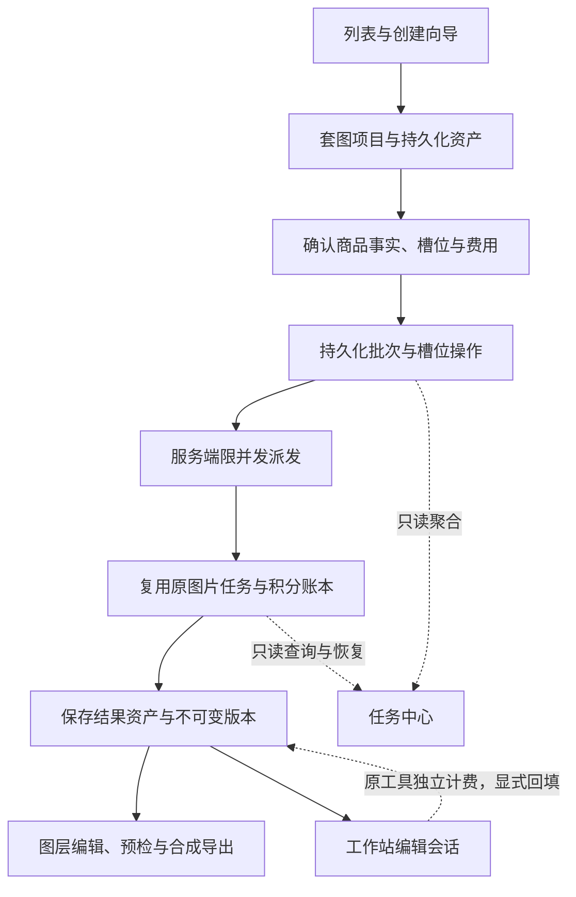

# 电商套图（E-commerce Suite）开发实施计划书

| 项目 | 内容 |
| --- | --- |
| 文档版本 | v2，2026-10-17 |
| 实现基线 | `main` / `fddfbf1`；本文所述现状以该提交为准 |
| 设计基线 | 用户提供的「套图工作台-html (1).zip」，见[原型说明](prototypes/ecommerce-suite/README.md) |
| 当前状态 | 开发计划与原型基线；套图页面、接口、表、调度器及预检规则均待实现 |
| 首期范围 | Home & Kitchen 三个子类，Amazon 美国站与通用模板，默认 7 槽位 |
| 交付目标 | 商品资料 → 槽位计划 → 真实生成 → 保存与恢复 → 图层与版本 → 工作站回填 → 平台预检与导出 |

本文保留附件的工作台布局、槽位切换、右侧三页签和吸底操作栏，补齐数据、任务、计费、资产和验收契约。五个阶段共同构成首期完整范围；阶段二仅验证最小闭环，不能据此宣称整套后台生成已完成。

## 一、产品范围与成功标准

### 1. 首期范围

- 商品类目：家具家居、厨房餐饮、收纳家纺，用于组织模板与输入建议，不表示覆盖全部细分类目的视觉规则。
- 平台：`amazon`（美国站）与 `general`。淘宝、Shopee、其他 Amazon 站点及 A+ 页面排在后续版本。
- 每个项目默认创建 7 个有稳定 ID 的槽位；允许跳过不适用的辅助槽位，首期不提供任意增加槽位。Amazon 模板保留主图槽位。
- 输入支持本地上传与“我的资产”；一张商品主体图为必需输入，细节实拍、其他角度与场景参考图按槽位补充。
- 支持首次整套生成、单槽位重生成、整体风格重生成、候选选择、文字与尺寸标注、版本切换、工作站回填、单图及 ZIP 导出。
- 真实生成使用已有服务端模型和积分账本；修改文字、切换版本、回填已有结果、普通本地合成与下载不新增生成费用。

首期不包含团队协同编辑、跨平台一键发布、自动认定商品或水印授权、自动重试失败的收费任务、未经确认的商品事实生成，以及新增订阅支付体系。

### 2. 成功标准

1. 三个子类各用至少 3 个真实商品走通创建、生成、编辑、恢复与导出；人工检查商品形状、颜色、品牌标识和配件数量。
2. 已保存项目可恢复原图、当前成品、历史版本、图层和提交身份；读取地址过期后能重新取得访问权限。
3. 已接受的整套批次由服务端驱动，关闭页面后仍能派发尚未提交的槽位；失败收费任务仅由用户手动发起新尝试。
4. 部分失败不丢失成功图片，不阻止导出其他可用槽位；费用可逐项追溯到原任务账本。
5. 深色、浅色、跟随系统及窄屏验收通过；导出的文字与标注线布局和预览一致。

## 二、附件原型与页面契约

### 1. 原型基线与边界

原始附件完整归档为 [workspace-v1.zip](prototypes/ecommerce-suite/workspace-v1.zip)，SHA-256 为 `4a100dba9c3dc120c2c9d8bb1639b653cdfaf365bebf0e44b304a5986670e048`。其中包含 `Main.dc.html`、支持脚本与 React 运行文件，设计预览尺寸为 1440 × 900。

已核对源文件及浏览器中的槽位切换、文字页签。沙发由 HTML 色块绘制，任务、版本、积分和进度属于演示数据，不构成模型生成或计费证据。附件未包含链接指向的 `List.dc.html`、`ToolReturn.dc.html`、`Export.dc.html`，相应行为以本文补齐。

| 区域 | 原型参考 | 产品实现要求 |
| --- | --- | --- |
| 导航与标题 | 购物袋图标，菜单高 42px、圆角 9px，顶部高 56px | 接入现有 `MainLayout`、菜单与面包屑，不复制全局外壳 |
| 内容布局 | 内容边距 20px，预览／设置间距 18px，卡片内边距 18px、圆角 12px | 宽屏主预览在左、参数在右，随现有侧栏宽度自适应 |
| 图片预览 | 正方形示例，图片最大宽度 480px，中性灰衬底 | 画板比例取实际成品／导出规格，图片与衬底分离，不拉伸商品 |
| 槽位条 | 88 × 88 缩略图、10px 间距、状态点与名称 | 使用实际缩略图，有状态文本、键盘焦点和选中态 |
| 右侧面板 | 参考宽度 330～360px；重生成／文字与标注／版本三页签 | 动态读取模型能力，各槽位的提示词、数量和编辑草稿独立 |
| 工作站入口 | 重绘、智能编辑、精修、重新打光 | 复用现有工具；底图不可读取时禁用并给出原因 |
| 底部栏 | `position: sticky; bottom: 0`，统计、检查、导出 | 使用真实状态，预留内容空间，不遮住末项设置或焦点 |
| 主题演示 | 右下角“演示 · 主题”开关 | 正式页面仅使用现有全局主题偏好 |

### 2. 演示行为的产品化约定

- 固定“62%”改为排队／处理中等阶段；只有上游提供可信进度时显示百分比。
- “N 积分”替换为服务端报价。报价加载、不可用或模型不可用时阻止提交，不显示免费。
- “保证整套图里的沙发一致”改为“以原商品图为参考，生成后请核对外观与细节”，提供原图对照入口。
- “本次未扣除积分”取实际账本状态：预扣中、结算中、已扣、已退还或未扣费；网络失败不能推断已退款。
- “离开此页也会继续”仅在持久队列与后台派发完成实际验证后启用；只有单项已提交时说明“已提交任务会继续”，本机模拟任务明确运行边界。
- 图层拖拽、标注线编辑、整体风格重生成、真实生成、预检和导出在附件中未形成完整实现，须单独开发验收。

### 3. 页面与生成入口

列表页 `/ecommerce` 提供新建、打开、重命名、复制配置和移入回收站。卡片展示平台、可用槽位数／启用槽位数、最近批次、保存状态和更新时间；复制配置不复制原任务或触发生成。

创建向导收集商品名称／可选 SKU、主体图、子类、平台／站点、标签与确认规格、文案语言与单位、统一风格和启用槽位。保存后进入 `/ecommerce/:id`，先预览生成计划与费用，再显式提交。

“整体风格重生成”先编辑风格、选择槽位范围并确认模型、规格、候选张数和费用；创建新批次并保留旧版本。项目有活动批次时禁止重复生成，可继续查看、编辑既有图层和导出已有成品。

分辨率显示 `1K／2K／4K`，接口值使用已有小写 `1k／2k／4k`。数量上限、比例、参考图数量和分辨率组合来自模型目录，不硬编码所有模型均支持 4K 或四张候选。

“重生成”页签按槽位处理方式切换控件：主图白底合成、尺寸标注等复用路径不展示无效的模型／候选数量选项，操作命名为“重新合成”或“更换原图”；主动使用 AI 编辑时从工作站入口独立确认费用。

### 4. 响应式与主题

- `>900px`：左右布局；复用工具箱／图片工作站的预览吸顶思路，仅在预览能完整容纳于可视区时吸顶。
- `<=900px`：预览在上、配置在下，正常滚动，不强制预览吸顶；槽位条可横向滚动。
- 短屏、放大字体和软键盘场景下，吸底栏必要时回退普通文档流；弹窗、抽屉可独立滚动。
- 图层颜色属于成品数据，不随界面主题变化；选择框、手柄与操作面板使用界面变量。

| 原型变量 | 仓库变量 |
| --- | --- |
| `--bg` / `--surface` / `--surface2` | `--color-bg` / `--color-surface` / `--color-surface-2` |
| `--canvas` / `--sidebar` | `--color-canvas` / `--color-sidebar-bg` |
| `--bd` / `--bds` | `--color-border` / `--color-border-strong` |
| `--tx` / `--tx2` / `--mut` | `--color-text-primary` / `--color-text-secondary` / `--color-text-muted` |
| `--ac` / `--acs` | `--color-accent` / `--color-accent-soft` |
| `--ok` / `--warn` / `--danger` / `--dangers` | `--color-success` / `--color-warning` / `--color-danger` / `--color-danger-soft` |

## 三、类目、商品事实与生成策略

### 1. 默认模板

| 子类 | 典型商品 | 默认 7 槽位 |
| --- | --- | --- |
| 家具家居 `furniture` | 沙发、桌椅、床、茶几 | 主图、居室场景、氛围场景、卖点图、尺寸图、材质／连接细节、使用场景 |
| 厨房餐饮 `kitchen-dining` | 锅具、咖啡机、保鲜盒、小家电 | 主图、厨房场景、材质／结构说明、功能卖点、尺寸／容量、部件细节、使用／成品场景 |
| 收纳家纺 `storage-textile` | 收纳箱、置物架、床品、窗帘 | 主图、居室陈列、空间／使用对比、卖点图、尺寸／规格、走线／卡扣细节、多场景展示 |

名称和提示词由版本化模板生成；`SlotKind` 表示语义，不把家具夜间场景固定用于全部商品。缺少尺寸、对比或内部结构等可靠输入时提示补资料，允许跳过辅助槽位。“7 槽位”是产品默认配置，不是平台规定的必需数量。

### 2. 标签与事实确认

保留推荐标签点选、回车添加、删除与去重交互。自由标签收集描述，底层另外保存结构化商品事实，不能用一个 `string[]` 同时承担规格、单位及真实性确认。

| 数据 | 规则 | 下游用途 |
| --- | --- | --- |
| 自由标签 | 最多 30 个，每个最多 80 字；去首尾空白、去重，并限制合成提示词总长度 | 整理商品描述与风格 |
| 规格 | 保存语义、原始值、单位、原文和确认状态 | 确认后用于尺寸、容量、重量或承重标注 |
| 材质／功能卖点 | 输入或选择后由用户确认；推荐项默认未确认 | 确认后用于提示词与独立文字图层 |
| 统一风格 | 配色、光照、场景基调、版式及模板版本 | 约束整套画面与文字样式 |
| 文案语言／单位 | 中文、英文及公制／英制展示 | 人工确认成品文案，与应用界面语言解耦 |

“长 210cm 宽 85cm”可解析为两个待确认规格，不能改写成“宽 210cm 高 85cm”。解析失败、语义冲突或缺少单位时保留原文，不猜数值。换算保留原始值和展示精度，不反向改写原始规格。

推荐项优先提供“现代简约”“暖光场景”等风格词。`304`、`承重 50kg`、`99% 遮光`、`食品级`等事实或性能表述不能默认勾选或直接写入成品。首期不增加隐式收费的文案模型调用，外语文案由用户编辑并确认。

### 3. 逐槽位处理路径

| 槽位 | 输入与处理 | 限制与计费 |
| --- | --- | --- |
| 主图 | 优先使用确认白底实拍；需要抠图时先显式调用现有工具，再确定性合成白底与留边 | 抠图依原规则计费／使用额度，本地合成不收费；不默认重造商品主体 |
| 场景／氛围／使用 | 以持久商品图为源调用 `image_edit`，有场景参考时复用融合请求参数 | 槽位独立提示词，使用支持该能力的模型，人工核对外观及使用关系 |
| 卖点／材质说明 | 原图或图像编辑底图，确认文案由独立图层排版 | 尽量要求模型不出文字，不补造内部结构或性能证据 |
| 尺寸／容量 | 原底图、确认规格、可编辑标注线进行确定性合成 | 不为数字调用图片模型；缺少确认规格时阻止对应槽位完成 |
| 细节 | 提供对应细节实拍，复用裁切或已有精修能力 | 没有可靠输入时提示上传或跳过，不生成未知接口、纹理与连接结构 |

首次整套批次前完成原图持久化及必要的主图抠图确认。浏览器产生的白底、裁切等结果先存为项目资产，再作为可复用结果参与批次，避免关闭页面后依赖尚未执行的本地处理。

每次生成冻结主体资产、参考图、已确认事实、统一风格、模板版本、提示词及模型规格。不同槽位引用同一商品身份，不自动把上一张未经确认的生成图作为下一张商品源图。提供原图对照和候选替换，不宣称提示词能保证商品一致性。

## 四、系统架构与现有能力复用



| 能力 | 当前证据 | 本模块新增内容 |
| --- | --- | --- |
| 路由与外壳 | [路由](../src/router/index.tsx)、[导航元数据](../src/router/meta.ts)、[布局](../src/layouts/MainLayout.tsx) | `/ecommerce`、`/ecommerce/:id` 及菜单，不重建全局导航 |
| 模型与报价 | [模型契约](../shared/image-models.ts)、[模型 API](../src/services/api/imageModels.ts)、[报价工具](../src/features/credits/quotes.ts) | 批次计划与费用汇总，按模型能力动态限制参数 |
| 图片任务 | [任务服务](../server/image-jobs/service.ts)、[事务执行](../server/image-jobs/execution.ts) | 关联原任务；单原任务当前最多 4 张，用户默认并发 2，仍受模型与全局限制 |
| 积分账本 | [计费端口](../server/image-jobs/billing.ts)、[任务创建](../server/image-jobs/lifecycle.ts) | 仅汇总原账本，不新增父批次收费账户或预扣状态机 |
| 任务中心 | [公共契约](../shared/task-center.ts)、[查询投影](../server/task-center/projection.ts)、[返回路由](../src/features/task-center/route.ts) | 来源校验、批次聚合、原任务详情、返回定位与恢复 |
| 资产与访问 | [存储](../server/storage.ts)、[资产访问](../src/cloud/assets.ts)、[结果身份](../src/features/assets/resultIdentity.ts) | 套图资产登记、长期引用及 URL 更新 |
| 工作站 | [工具注册](../src/features/image-workstation/tools/registry.ts)、[原图编辑](../src/features/image-workstation/tools/requestBuilders/imageEdit.ts)、[融合请求](../src/features/image-workstation/tools/requestBuilders/fusion.ts) | 可恢复输入、回填会话及版本冲突保护 |
| ZIP 与下载 | [共用打包器](../src/pages/Toolbox/shared/zip.ts)、[流水线下载](../src/features/toolbox-pipeline/download.ts) | 新增成品渲染与命名，复用 ZIP 库与体积限制 |
| 主题 | [全局变量](../src/styles/global.css)、[主题状态](../src/store/useThemeStore.ts) | 使用第二节映射，遵循现有主题偏好 |

`CreditSpendGate` 当前是[同步工具费用确认组件](../src/features/credits/CreditSpendGate.tsx)，不能仅接入它就完成图片批次计费。批次确认面板复用已有报价展示；同步抠图等继续走各自确认与账本流程。

建议新增 `src/features/ecommerce-suite/`，含 `config/`、`types.ts`、`store.ts`、`api.ts`、`persistence/`、`generation/`、`render/` 和页面组件；服务端新增 `server/ecommerce-suite/` 的路由、仓储、报价、资产、调度和回填服务。共享验证契约放入 `shared/ecommerce-suite.ts`。

Zustand 管理当前编辑草稿、选中槽位／图层及本地保存状态；项目、批次、原任务和账本由现有查询层获取。不能在页面、任务中心和新轮询器各自维护一份原任务状态。版本分页读取，列表不返回全部历史或图片字节。

## 五、数据模型与持久化

### 1. 核心类型草案

以下是阶段一需冻结的目标契约，不是已新增代码。读取响应可附带短期 URL，持久身份只保存资产与原任务标识。

```typescript
export type SuiteScope = 'local' | 'preview' | 'production'
export type SuitePlatform = 'amazon' | 'general'
export type SuiteSubcategory = 'furniture' | 'kitchen-dining' | 'storage-textile'
export type SlotKind = 'main' | 'scene' | 'atmosphere' | 'feature' | 'size' | 'detail' | 'use'

export interface SuiteActor {
  userId: string
  runtimeScope: SuiteScope
}

export interface SuiteAssetRef {
  assetId: string
  objectKey: string
  mimeType: 'image/jpeg' | 'image/png' | 'image/webp'
  width: number
  height: number
  bytes: number
  checksum: string
}

export interface SuiteFact {
  id: string
  kind: 'dimension' | 'capacity' | 'weight' | 'load_capacity' | 'material' | 'feature'
  name: string
  value: string | number
  unit?: string
  originalText: string
  source: 'user' | 'tag_parse'
  confirmed: boolean
}

export interface SuitePoint {
  x: number // 相对成品画板的归一化坐标，范围 0～1
  y: number
}

export interface SuiteTextLayer {
  id: string
  type: 'text'
  text: string
  position: SuitePoint
  width: number // 相对画板宽度，范围 0～1
  fontFamily: string
  fontSize: number // 设计画板像素，导出时按比例缩放
  fontWeight: number
  color: string
  background: string
  align: 'left' | 'center' | 'right'
  zIndex: number
}

export interface SuiteDimensionLayer {
  id: string
  type: 'dimension'
  factId: string // 必须关联已确认规格
  start: SuitePoint
  end: SuitePoint
  labelPosition: SuitePoint
  color: string
  strokeWidth: number
  fontSize: number
  zIndex: number
}

export type SuiteLayer = SuiteTextLayer | SuiteDimensionLayer

export interface SuiteTaskRef {
  sourceKind: 'image_job' | 'sync_credit'
  sourceId: string
  requestId: string
  ordinal: number
}

export interface SuiteSlotVersion {
  id: string
  projectId: string
  slotId: string
  versionNumber: number
  parentVersionId?: string
  assetId: string
  source: 'reuse' | 'generated' | 'annotation_edit' | 'workstation_return'
  sourceTask?: SuiteTaskRef
  sourceTool?: 'repaint' | 'smart-edit' | 'retouch' | 'relight'
  modelProfileId?: string
  resolution?: '1k' | '2k' | '4k'
  promptSnapshot?: string
  templateVersion: string
  renderSize: { width: number; height: number }
  layersSnapshot: SuiteLayer[]
  factsSnapshot: SuiteFact[] // 只冻结本版本使用且已确认的事实
  copyLanguage: 'zh-CN' | 'en-US'
  unitSystem: 'metric' | 'imperial'
  rendererVersion: string
  createdAt: string
}

export interface SuiteSlot {
  id: string // 稳定 UUID，不使用数组下标作为身份
  kind: SlotKind
  name: string
  order: number
  enabled: boolean
  referenceAssetIds: string[]
  activeVersionId?: string
  headRevision: number // 当前版本指针的并发保护
}

export interface SuiteProject {
  schemaVersion: 1
  id: string
  actor: SuiteActor // 来自服务端身份，不接受客户端自报归属
  revision: number // 项目配置的乐观锁版本
  title: string
  sku?: string
  category: 'home-kitchen'
  subcategory: SuiteSubcategory
  platform: SuitePlatform
  marketplace?: 'US'
  ruleProfile: { id: string; version: string }
  baseAssetId: string
  tags: string[]
  facts: SuiteFact[]
  copyLanguage: 'zh-CN' | 'en-US'
  unitSystem: 'metric' | 'imperial'
  style: { palette: string[]; sceneTone: string; templateId: string; templateVersion: string }
  slots: SuiteSlot[]
  createdAt: string
  updatedAt: string
  deletedAt?: string
}
```

图层选择态、页签与悬停态不进入成品版本。项目配置 `revision`、槽位指针 `headRevision`、批次／任务状态分别更新，避免后台进度刷新导致配置保存冲突。

### 2. 批次、操作与会话

| 实体 | 必须保存的身份与约束 |
| --- | --- |
| `SuiteBatch` | ID、账号／环境、项目、幂等请求号、配置与报价快照、有效期、总预算、派发截止、创建／完成时间；无独立收费状态 |
| `SuiteOperation` | ID、批次／槽位、处理方式（复用／图片编辑）、稳定原请求号、原任务绑定、提交阶段、输入参数快照、结果序号、租约／隔离令牌与错误 |
| 结果版本 | 用 `sourceKind + sourceId + ordinal` 去重；对象另外登记到项目资产；一个操作可产生多个候选 |
| `SuiteBridge` | 会话 ID、归属、项目／槽位／来源版本、来源 `headRevision`、输入资产、目标工具、原结果身份、过期与回填记录 |
| 编辑草稿 | 项目／槽位／基准版本、图层与提示词草稿、更新时间及待保存修订；独立于不可变版本 |

原任务继续使用 `queued / processing / succeeded / failed / expired / cancelled`。操作另记录 `waiting / dispatching / confirming / bound / blocked / stopped` 等编排阶段；`confirming` 表示创建事实尚待确认，不能等同失败。

批次持久状态区分 `queued / running / blocked / succeeded / partial / failed / stopped`，由操作与原任务派生；`partial` 仅用于全部项已收口且有成功、有失败／停止项的批次。原任务及复用结果成功登记即为批次完成，是否选用候选单独显示；等待选择不占用活动批次名额。

项目“草稿／处理中／部分完成／已完成”由启用槽位、可用当前版本和活动批次派生。重生成失败仍显示旧成品及本次失败提示。“5/7”指本批次目标槽位完成数，成功候选张数单独统计，不能混用分母。

### 3. 存储与隔离

首期采用 **云端元数据事实源 + R2 持久资产 + IndexedDB 本地完整恢复备份**。离线编辑可保存本机，登录且云端保存成功后才能提交真实收费任务；本机演示不承诺后台继续执行。

拟在既有 `aigc` schema 新增以下表；字段、索引、约束与迁移在阶段一冻结后实现：

| 表 | 职责 |
| --- | --- |
| `suite_projects` | 商品事实、风格、平台规则版本、配置修订与软删除 |
| `suite_slots` | 稳定槽位、启用状态、当前版本及 `headRevision` |
| `suite_assets` | 原图／参考图／结果／缩略图身份、尺寸、对象键、校验值与可用性 |
| `suite_versions` | 不可变成品及图层快照、原任务结果和版本序号 |
| `suite_batches` | 已确认的计划、预算、派发期限与批次身份 |
| `suite_operations` | 待派发项、稳定请求号、原任务绑定、结果应用与租约 |
| `suite_bridges` | 可恢复工作站会话及幂等回填 |

- 各表携带 `user_id` 与 `scope`，复用 [withIdentity](../server/db.ts) 和 `aigc_api`；启用 RLS，读写同时检查账号、环境、有效成员身份。参考 [Supabase RLS 文档](https://supabase.com/docs/guides/database/postgres/row-level-security)。
- 外键关联和对象读取同时验证归属、环境及项目；知道 UUID／对象路径不构成访问权限。请求体不能决定实际归属和环境。
- 批次唯一键为 `(user_id, scope, request_id)`；原任务请求号仍受原表约束保护，同键不同参数返回冲突。
- 版本序号事务分配，原结果入版本、桥接回填均有去重约束；账号与环境必须覆盖复合关联条件。
- 去重针对目标槽位的生成／回填落库事件；图层编辑允许复用同一资产创建不同版本，不能以资产 ID 全局唯一阻止版本保存。
- 缓存键包含 `userId + runtimeScope + projectId`；切换账号中止旧查询、写入、回填，拒绝旧响应覆盖。
- 不把套图 JSON 塞入现有画布 `ProjectSnapshot` 或套用仅验证画布节点的项目接口；复用底层设施，套图拥有独立契约。

### 4. 资产寿命与保存恢复

1. 上传校验实际格式、尺寸、字节及归属后登记长期资产。`temporary/task-inputs` 不能作为长期原图；需为套图前缀补充原生成服务的归属校验兼容。
2. 原任务结果必须取得长期项目引用，避免原任务清理导致版本失效。对象写入与数据库分开，先核验对象，再事务关联；孤儿清理前再次检查所有引用。
3. 原任务成功但版本登记／转存／缩略图失败，只修复登记与资产，不重做生成或改写账本。原任务与账本查询不依赖项目是否打开。
4. 签名 URL 仅在访问响应及内存缓存出现，持久化保存资产 ID／对象键。过期重新授权；真正缺失显示资源不可用，不归类成新的生成失败。
5. 配置与图层草稿默认 800ms 防抖保存；提交、切换基准版本、进入工作站、导出前刷新保存。写入带 `expectedRevision`，409 保留本机副本并提示读取云端或另存，不静默覆盖。
6. 本地备份包括配置、历史版本／图层、原任务身份和已缓存原图／结果 Blob；不存签名地址、令牌、密钥。只有全部相关 Blob 落盘才显示“本地完整备份已就绪”，空间不足提示降级并提供含图片的恢复 ZIP。
7. 恢复包校验格式版本与文件；导入仅恢复草稿及成品，不能恢复可执行队列、重放请求或获得原云端权限。收费生成需重新上传并确认。
8. 删除使用 7 天回收站，停止尚未派发项；已提交原任务继续收口与结算。到期仅清理无其他引用的资产；账本和原任务遵循原有留存。首期不静默裁剪版本，存储达到既有限额时阻止新增并引导清理。

## 六、真实生成、后台编排与任务中心

### 1. 计划、报价与提交

1. 服务端校验归属、已保存配置修订、确认事实、输入资产和槽位前置条件，冻结生成计划。
2. 按模板组装统一风格与独立槽位提示词，提交前展示摘要并校验合成后的长度；来源元数据不传给供应商。
3. 默认模型从现有可用目录选择，允许用户在支持对应能力的模型中切换；Key 与供应商地址仅在服务端配置。
4. 规范化实际规格后报价；4K／比例会降级时先展示实际输出、警告及价格，再确认，不能隐式切换。
5. 用户确认槽位、候选数量、模型、费用上限和有效期后，幂等创建批次与持久操作；落库成功才返回“服务端已接收”。
6. 响应丢失时按原批次 `requestId` 查找；不明确时保留“提交确认中”，不换编号重新提交。

首次整套每槽位默认 1 张候选，单槽位重生成可选模型支持范围内的 1～4 张。主图、尺寸等复用步骤标明复用／本地合成，不伪装成免费模型任务。

### 2. 服务端派发协议

- 沿用现有受保护维护入口模式，新增 `POST /api/internal/ecommerce-suite-maintenance`，复用调度部署方式、鉴权及运行预算；浏览器定时器不负责派发。
- 每项目最多一个活动批次，首期每用户套图派发并发默认 1；与原图片任务用户并发、小时频率、模型和全局限制共同生效。
- 短事务领取操作，写入租约、隔离令牌和稳定请求号。原任务创建、积分预扣和操作绑定必须在同一数据库事务完成；复用／适配 `createImageJobInStore` 与原事务执行接口，供应商与对象 I/O 放在事务之外。
- 创建后调用原图片任务执行流程，由原服务负责供应商提交、未知结果确认与轮询。套图调度器不直接调用供应商，也不改全局 `IMAGE_BACKGROUND_SUBMIT_ENABLED` 绕过保护。
- 租约过期先查原绑定与稳定请求号。已有原任务只读取并修复绑定；供应商是否接收不明时沿用原确认机制，不再次提交收费任务。
- 明确未创建原任务的容量限制可按 `retryAfter` 延迟首次派发，这是已确认计划的首次执行；无法确认是否执行时不得按“未创建”处理。
- 首期派发窗口为接收后 30 分钟，使用用户已确认预算；到期停止未派发项，已创建任务继续按原截止时间完成。用户可重新确认未执行项形成新批次。
- 余额不足、价格变化、模型下线或输入缺失时停止后续派发并给原因，用户处理并再次确认后才继续未执行项，成功项不重复生成。
- 重新确认生成新批次前，事务终结旧批次的未派发项并使旧租约失效；只纳入明确未执行或用户选择重试的失败项。原任务尚待确认的项不能换新编号绕过确认。
- 恢复、GET 查询、页面挂载及重登不产生失败任务的新尝试。用户点“重试”才创建新尝试，保留与原失败操作的关联。

### 3. 结果应用与停止

- 结果按原任务与结果序号幂等登记，先保存候选版本；不能把下载／转存失败变成重新生成。
- 首次生成且槽位无成品、`headRevision` 未变、无冲突草稿时，单一成功候选可自动设为当前；多候选等待选择。
- 应用结果前后检查本机草稿修订；无法确认是否冲突时仅存候选。云端指针变化不能清空尚未同步的本地编辑。
- 重生成保留旧成品；用户显式“设为当前”才替换。晚到结果不能覆盖已选版本或图层草稿。
- 局部成功保留候选与实际收费；手动重试仅包含明确选择的失败项，不能重新提交成功项。
- 可导出数按当前成品可读及资料有效计算，批次完成数按冻结计划计算。完成／等待选用／失败应分别展示。
- 停止只作用于尚未创建原任务的操作，不承诺取消上游已接收任务或免除成功费用。领取与停止共用事务保护，旧租约不能在停止后派发。

### 4. 任务中心扩展

仅修改 `taskTools` 不足以集成，须同步改共享校验、查询投影、来源映射、路由、通知和恢复。

| 项目 | 目标契约 |
| --- | --- |
| 子任务来源 | 新增 `entry: 'ecommerce'`、`tool: 'ecommerce-suite'` 与项目／槽位／批次／操作 ID；同时验证 `image_edit` 能力和数据库操作绑定 |
| 原任务身份 | 图片沿用 `image_job`，同步工具沿用 `sync_credit`；原 ID、计费和恢复语义不变 |
| 批次摘要 | 新增只读 `suite_batch` 适配器，`sourceId` 为批次 UUID；聚合进度及原账本，不负责派发 |
| 计数 | 批次 `requestedCount / completedCount` 使用目标槽位数；原任务详情保留候选张数与部分成功 |
| 状态 | 等待映射排队中，派发／原任务活动映射处理中；终态局部成功使用部分完成展示，停止且无完成项映射已取消 |
| 费用 | 合计原子任务预扣、结算与退还；未知账本保持结算中并显示已知金额，不能按 0 计算 |
| 侧栏 | 同批次折叠为一项，详情展开原任务；活动数量不重复计父子，无关工作站任务独立显示 |
| 返回 | 批次定位 `/ecommerce/:id?batch=:batchId`，子任务继续定位槽位及原任务，不猜测其他项目 |
| 恢复 | 账号／环境隔离，原请求查找、只读恢复、晚到响应保护；同步扩展来源枚举、游标校验与 UI 状态约束 |

后台定时调用连续运行、原任务维护正常、关闭浏览器后尚未提交的槽位仍能派发并收口，是阶段三发布条件。前端轮询通过或仅有一条维护器日志不能替代该验收。

## 七、积分与成本约定

### 1. 事实源与预算

图片沿用原 `BillingPort.reserve / settle / release`、任务创建事务和成功张数结算；同步工具仍走自身账本。父批次只组织确认与金额汇总，不重复预扣同一原任务。

报价取模型目录实际单价，本文不固定可能变化的分辨率费率。确认快照包含模型、规范化规格、每张单价、数量、报价指纹、有效期和总预算。报价接收有效期默认 10 分钟，仅用于创建批次；已接收批次在 30 分钟派发窗口内逐项复核价格与预算。价格／模型变化停止未执行项，不能悄悄涨价或换模型。

整套开始前检查余额覆盖预计总额，但不锁定整套金额；其他任务仍可能消耗余额。每个原任务事务预扣，中途不足进入待处理状态，已完成项正常结算。确认面板明确提示这一行为和派发期限。

### 2. 具体收费场景

| 场景 | 收费与可见结果 |
| --- | --- |
| 生成 4 张、成功 4 张、最终只选 1 张 | 按成功 4 张收费，选用结果不改变已发生费用 |
| 生成 4 张、仅 2 张成功 | 原任务按成功 2 张结算，其余预扣退还，保留成功候选 |
| 原任务失败／超时 | 原服务释放预扣，确认前展示实际账本状态 |
| 超时后恢复晚到结果 | 沿用原服务晚到结果规则，不重新追扣或另算费用 |
| 工作站编辑 | 按原工具规则确认收费，回填不再次扣费 |
| 改图层、切历史、复用成功结果、普通导出 | 不触发收费生成；下载失败仅重试下载／合成 |
| 新批次重做旧成功槽位 | 属于新的收费任务，提交前再次确认范围及费用 |

版本关联失败、页面崩溃或备份失败都不能成为重做收费生成的理由。供应商成本沿用原任务元数据，不将模型成本或原型占位积分当作用户实际账单。

## 八、图层、完整版本与工作站回填

### 1. 图层与渲染

- 文字胶囊支持 4 色底色、字体大小、文字颜色、拖拽、键盘微调、层级及删除；首期每槽位最多 20 层，单文本最多 200 字。
- 尺寸图支持端点、标注线和标签位置，数字从确认规格格式化得到。修改数值先更新并确认事实，再生成新标注快照。
- 使用成品画板坐标，支持安全边距、越界提示及长文本换行；字体与笔画按画板比例缩放，不能使用窗口／衬底坐标。
- 预览与导出共用测量、换行、线段、缩放和绘制逻辑；等待指定字体可用，使用覆盖对应语言且具有分发许可的固定字体资源。
- Amazon 主图锁定按平台、站点、规则版本及 `kind: 'main'` 判断，不依赖 `id === 0`；接口和导出同样校验。
- 平台切换保留原草稿并重新检查。锁定图层不证明底图没有文字／水印，底图内容仍需核对。

### 2. 不可变版本与草稿

版本冻结底图、画板、图层、已确认事实、文案语言／单位、渲染器和模板版本及原任务来源；尺寸标签必须从本版本事实快照渲染，不能读取后来改过的项目规格。模型和规格只保存真实信息，本地复用不伪造模型。

自动保存写独立草稿；用户保存图层修改、切换基准或导出前，将变更形成新的 `annotation_edit` 版本，无变化不建空版本。历史“设为当前”恢复底图与全部图层，保留切换前未保存草稿，不修改历史内容。

### 3. 工作站桥接

1. 保存草稿并创建会话，冻结来源版本、输入资产及 `headRevision`。默认传入无文字底图，图层留在套图；主动选择合成图时提示文字已烘焙，不能作为原独立层编辑。
2. URL 仅携带不透明 `bridgeId`，服务端校验归属后解析输入；不在 URL 放签名地址、完整提示词或图片字节。补充工作站输入适配与恢复，不复用别的任务输入绑定。
3. 原工具任务保留真实 `entry: 'workstation'` 和目标工具，通过经验证的可选桥接关联追踪，不改成套图生成任务或重复纳入批次费用。
4. 完成后用户显式选择“回填到电商套图”，提交会话与原结果身份；服务端验证归属、成功结果和有效期后幂等追加版本。
5. 会话有效期 7 天，同会话同原结果重复点击返回同版本；不同候选可各追加一次。过期可基于有权限资产重建会话，不重新生成图片。
6. 来源当前版本／图层草稿已变时只存候选，显示来源版本并等待选择；不自动覆盖。画板尺寸变化时重排或重新确认图层。
7. 项目在回收站提示先恢复，已清理或账号／环境变化拒绝回填；原工作站结果仍按原权限访问和下载。

## 九、平台预检与导出

### 1. 预检边界与规则来源

界面使用“平台预检”，说明“检查结果供发布前核对，不代表平台审核通过”。结果包含 `pass / warning / unknown / fail`、规则 ID／版本、平台／站点、被检版本、时间、依据与修复建议；图片、图层或导出配置变化后，旧检查失效。

Amazon 公开说明列出最长边 500～10,000px、JPEG／TIFF／PNG／非动画 GIF 等要求，并建议至少提供 6 张图片；要求与推荐须区分。首期支持其中的 JPEG／PNG，WebP 仅用于通用模板。[Amazon 官方图片说明](https://sell.amazon.com/blog/product-photos)

主图内容规则结合美国站及具体类目的 [Product image requirements](https://sellercentral.amazon.com/help/hub/reference/external/G200216080) 核对。上线前登记规则来源与复核日期，不把通用 Home & Kitchen 模板宣称为全类目认证。

预检分两步：服务端检查冻结的资产、图层与输出配置，浏览器在最终编码后再检查实际文件元数据；不能把请求中的格式／尺寸选项当成已导出文件的检查证据。

| 检查项 | 首期方法 | 无法确定时的行为 |
| --- | --- | --- |
| 格式、真实宽高、比例、大小 | 读取实际导出编码文件的元数据 | 读取失败记 `fail`，阻止该文件导出 |
| 主图叠加文字／角标 | 检查版本快照与平台规则 | 被禁止图层记 `fail`，不据此认定底图内容合规 |
| 白底与商品占比 | 有可信前景蒙版时检测背景与主体包围盒，记录方法、阈值和蒙版来源 | 无可靠蒙版或透明／边缘商品难判断时记 `unknown`，人工核对 |
| 底图文字、水印、商品外观 | 首期提供原图对照与人工确认，OCR 等后续另评估 | 无自动依据时记 `unknown`，不输出“无未授权内容” |
| 规格与文案 | 检查引用事实已确认、无缺失和冲突 | 未确认规格记 `fail`，补资料或跳过对应槽位 |

Amazon 主图预设白底且无叠加文字；默认 2000 × 2000 JPEG 是本产品输出预设，不是平台唯一合法尺寸。原图像素不足说明放大影响并让用户处理，不隐式调用收费增强。首期阻止确定性 `fail` 文件导出；`warning / unknown` 展示原因并由用户核对确认，不能静默计为通过。

### 2. 导出协议

- 选择槽位、平台预设、实际像素、格式、JPEG 质量及透明背景策略；默认导出当前已保存版本，预先列出缺失、失败和跳过项。
- 先保存并冻结版本、图层和配置清单；导出中切换版本或收到新结果，不改变本次文件。
- 共用渲染器合成底图、文字与标注；选择框和控件不进入成品，界面主题不影响颜色。
- Amazon 首期仅 JPEG／PNG，主图输出不透明白底；通用可 PNG／JPEG／WebP。JPEG 编码前显式铺底，避免黑底或意外丢失透明信息。
- 从受控资产访问取原图，URL 过期可重新签名再读；CORS／对象缺失只影响对应文件，不触发生成。
- 沿用共用 ZIP 的 200 MB 结果总量限制。4K 逐张解码、合成，及时释放位图和 Blob URL，不同时加载全部历史版本。
- 命名为安全化的 `项目名_序号_槽位名_版本_宽x高.扩展名`，清理路径字符、处理重名；下载前展示文件数与预计体积。
- 单文件失败列出原因，可重试该文件或确认仅导出成功项；ZIP 附 `manifest.json` 记录配置、版本、文件与跳过原因，不包含签名地址或令牌。
- 恢复 ZIP 与普通成品 ZIP 使用不同入口和格式版本，普通成品包不携带可执行任务状态。

## 十、目标接口与错误约定

以下均为拟新增接口，以 `/api` 为前缀；阶段一冻结请求／响应 Schema 后实施。读取保持只读，写请求检查归属、环境、版本及幂等身份。

| 接口 | 行为 |
| --- | --- |
| `GET /ecommerce/suites` | 分页项目摘要，按平台／状态筛选 |
| `POST /ecommerce/suites` | 幂等保存草稿，不开始生成 |
| `GET /ecommerce/suites/:id` | 配置、当前版本、修订与批次摘要 |
| `PATCH /ecommerce/suites/:id` | 带 `expectedRevision` 更新，冲突返回 409 |
| `POST /ecommerce/suites/:id/assets` | 受控上传或有权限资产导入，完成校验后登记 |
| `POST /ecommerce/suites/:id/quotes` | 规范化计划、预算和有效期，不预扣、不派发 |
| `POST /ecommerce/suites/:id/batches` | 校验确认报价／配置，幂等创建批次及操作 |
| `GET /ecommerce/suites/:id/batches/by-request/:requestId` | 找回提交响应丢失的原批次，不派发、不重提 |
| `GET /ecommerce/suites/:id/batches/:batchId` | 槽位、原任务、费用与结果关联 |
| `POST /ecommerce/suites/:id/batches/:batchId/stop` | 停止未派发项，原任务继续结算 |
| `GET /ecommerce/suites/:id/slots/:slotId/versions` | 分页版本，短期地址单独刷新 |
| `POST /ecommerce/suites/:id/slots/:slotId/versions` | 幂等保存图层为新版本，校验基准版本 |
| `PATCH /ecommerce/suites/:id/slots/:slotId/current` | 带 `expectedHeadRevision` 切换当前版本 |
| `POST /ecommerce/suites/:id/bridges` | 保存上下文并建立会话 |
| `GET /ecommerce/bridges/:bridgeId` | 工作站按当前身份解析输入和来源 |
| `POST /ecommerce/bridges/:bridgeId/results` | 验证原工具结果后幂等追加版本，不收费、不生成 |
| `POST /ecommerce/suites/:id/prechecks` | 检查冻结版本与配置，不调用收费模型 |
| `DELETE /ecommerce/suites/:id` / `POST /ecommerce/suites/:id/restore` | 回收站删除／恢复，不删除原账本 |

上传完成、资产访问／续签和本地恢复包作为同一资产子契约实现，上表省略子路径不意味着省略校验、上传确认或重新授权。

沿用 `INSUFFICIENT_CREDITS`、`RATE_LIMIT`、`TASK_EXPIRED`、`ACCOUNT_CHANGED` 等原错误；新增错误至少区分配置冲突、报价变化、批次冲突、资料待确认、会话过期和资产缺失。拒绝访问不能泄露他人项目是否存在；未知提交不能统一转为可立即重试的网络失败。

## 十一、五阶段实施路线

### 阶段一：原型与契约冻结

- [ ] 固定附件、尺寸节律、主题映射和缺失页面的补充交互。
- [ ] 冻结类目、事实确认、处理路径、模型参数和费用确认行为。
- [ ] 冻结项目／资产／版本／批次／操作／会话 Schema、API 与状态映射。
- [ ] 设计 RLS、原事务绑定、唯一约束、租约、长期引用与回收；按正式迁移流程生成文件，不手改生产数据库。
- [ ] 补齐故障矩阵、真实商品样本和各阶段证据格式。

**退出条件：** 每个操作都有状态来源、保存位置、收费与失败行为；不保留“加枚举即可集成”或未经验证的后台继续承诺。

### 阶段二：单槽位真实闭环

- [ ] 接入导航、路由、列表、创建向导、三子类模板和真实资产上传。
- [ ] 实现云端保存、本地备份、冲突提示、签名刷新与重开恢复。
- [ ] 实现工作台、大图／缩略图、动态模型参数、报价和单槽位原任务提交。
- [ ] 实现原请求只读查找、结果登记、实际费用与基础下载。
- [ ] 未实现整套持久派发时不显示整套后台继续文案。

**退出条件：** 真实商品走通保存 → 生成 → 账本结算 → 版本 → 刷新恢复 → 下载；响应丢失不重复 POST 或扣费。

### 阶段三：整套编排与任务聚合

- [ ] 实现确认计划、持久操作、维护处理器、限并发及原任务事务绑定。
- [ ] 实现关闭页面后的首次派发、租约恢复、停止未派发项和预算／余额／模型变化处理。
- [ ] 实现部分成功、手动重试、候选选择及晚到保护。
- [ ] 扩展来源与 `suite_batch` 适配器、侧栏折叠、原任务详情与返回定位。
- [ ] 目标环境验证定时调用和独立收口，不依赖浏览器。

**退出条件：** 7 槽位成功／活动／失败混合存在，关页后仍继续；重复领取、查询和重开不重复任务或计费。

### 阶段四：图层、版本与回填

- [ ] 实现文字、拖拽／键盘微调、尺寸线、确认规格引用与主图锁定。
- [ ] 实现草稿、不可变快照、历史切换、当前指针保护和统一渲染器。
- [ ] 实现四类工作站输入、会话恢复、结果校验、幂等回填和冲突处理。
- [ ] 实现带标注单图导出和含图片恢复包。

**退出条件：** 历史恢复底图及图层；原工具仅按原规则收费，重复回填与过时来源不覆盖成品。

### 阶段五：预检、批量导出与发布验收

- [ ] 实现规则版本、检查证据和四类结果，复核美国站目标类目规则。
- [ ] 实现槽位选择、JPEG／PNG／通用 WebP、尺寸质量、ZIP 清单及部分失败处理。
- [ ] 实现回收站、引用保护与清理，核对原任务独立生命周期。
- [ ] 完成三类真实商品、深浅主题、窄屏／短屏、字体及 4K 导出验收。
- [ ] 完成迁移、实际应用角色、目标环境调度／供应商／账本验证与回退演练。

**退出条件：** 故障矩阵有逐项证据；模拟、本地、真实 HTTP、供应商、账本、迁移与调度启用分别记录，不互相替代。

## 十二、故障矩阵与验证要求

| 场景 | 预期行为／断言 |
| --- | --- |
| 按钮连点、同键重复请求 | 只创建一份项目／批次；同键不同参数冲突 |
| 批次提交响应丢失 | 原请求找回，不新建批次或原任务 |
| 原任务创建后关联／响应丢失 | 稳定请求号恢复绑定，不再次预扣或提交上游 |
| 并发领取、旧租约晚到 | 仅有效租约可创建／绑定，无重复任务或版本 |
| 关页、断网、浏览器重启 | 已接收计划继续；恢复只读，草稿从本机恢复 |
| 7 槽位中 2 个失败 | 成功项保留可导出，手动重试只含所选失败项 |
| 4 张候选仅 2 张成功 | 候选与实际收费均为 2，槽位数与张数分开 |
| 余额不足、报价变化、模型下线 | 停止未派发项，保留已发生费用，再确认后继续 |
| 限流、派发窗口到期 | 首次派发按规则等待，到期停止未执行项，不循环建任务 |
| 未知提交、超时后晚到 | 原服务收口，恢复不重提，不改写旧成品及账本 |
| 成功但版本／资产登记失败 | 仅修复登记或转存，不重新生成、重复收费 |
| 签名过期、原任务被清理 | 重新授权，项目长期资产可读，真正缺失明确提示 |
| 账号／环境切换、伪造关联 ID | 查询、缓存、写入、RLS、对象访问及回填均隔离 |
| 空间不足、云保存失败、409 | 明示状态、保留本机副本，不虚报已完整保存 |
| 重复回填、来源版本已变 | 幂等追加候选，不覆盖当前成品 |
| 主图位于非零序号、平台切换、底图带字 | 按语义锁定，底图内容保留人工核对，不误报通过 |
| 尺寸缺失、单位冲突、未确认性能词 | 不自动出确定性规格图或事实文案 |
| 历史回退、规格更改、画板比例变化 | 恢复本版本完整快照，预览／导出坐标、换行及线段一致 |
| 导出中版本切换、单图失败、地址过期 | 冻结快照，仅重试读取／编码，可确认导出成功项 |
| 4K、多图、ZIP 超限、取消 | 逐张释放内存，超限提示拆分，不启动收费生成 |
| 删除／恢复／清理时仍有活动任务 | 未派发项停止，原任务正常结算，引用中资产不误删 |

验证分层：纯逻辑检查覆盖参数、状态、报价、坐标和去重；真实 PostgreSQL 验证 RLS、原事务预扣／回滚、租约、约束及并发；HTTP 验证鉴权、幂等与只读；浏览器验证草稿、恢复、主题、布局及实际下载；真实供应商验证外观、部分失败与费用收口。

视觉至少覆盖 1440 × 900、1280 × 720、900px 临界宽度、375px 窄屏及侧栏展开／收起，加入长提示词、20 图层和多候选。文件验收读取真实编码格式、像素、文字／标注位置及 ZIP 清单，不能仅断言点过下载。

脱敏证据建议放入 `docs/verification/ecommerce-suite/`，记录提交、环境、模型、样本、原请求／任务身份、账本核验和未覆盖项；不包含私有商品图字节、签名地址及密钥。业务实现运行相关测试及仓库构建／检查；纯文档阶段检查链接、类型示例、原型完整性和差异。

## 十三、发布与回退

- 入口、整套派发、高级导出使用可独立关闭的功能开关；关闭入口后原任务仍可收口、查询费用并下载结果。
- 按新增表／兼容来源契约 → 只读接口与页面 → 单槽位生成 → 调度器 → 整套入口顺序上线，先验证后台能力再开启承诺文案。
- 迁移仅影响 AIGC 模块及列明的任务中心兼容点，不改共享 Auth 或其他产品权限；RLS 用实际应用角色验证。
- 回退先停止新批次和未执行项派发，保留原任务执行、恢复、账本与成品；不能用删表、删对象、重置积分撤回功能。
- 交付分别报告代码、本地检查、迁移、真实 HTTP、供应商、调度、账本和视觉／导出结果；未验证项单列，不用演示或模拟替代。
