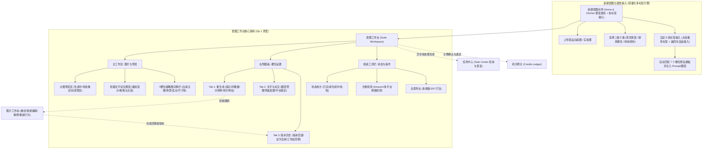
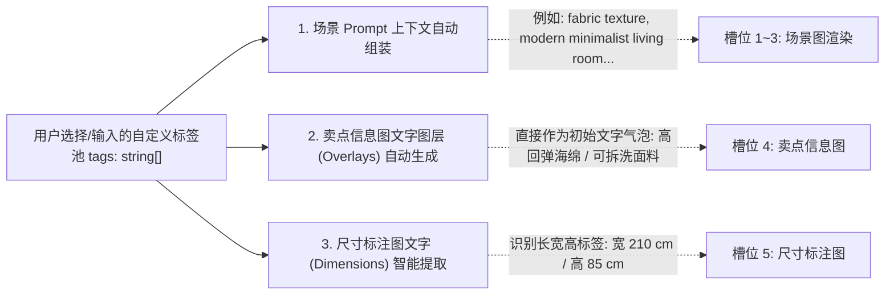

# 电商套图（E-commerce Suite）开发实施计划书

本计划以 **Zip 1（`Main.dc.html`）设计原型** 为核心骨架与视觉基准，紧密结合 Pixel AIGC 现有技术栈（React 18、TypeScript、Ant Design 5、Zustand、`@shared/task-center` 及深浅主题系统），规划「电商套图」模块的端到端落地实施方案。

---

## 一、 系统架构与业务全景

### 1. 业务流程与架构拓扑



---

## 二、 类目划分与「自定义多标签」机制设计

### 1. 垂直类目聚焦：Home & Kitchen（家居与厨房）
在 Amazon 等主流跨境电商中，Home & Kitchen 为体量最大、商品视觉要求最高的品类。系统在此大类下划分为 3 个核心子类，由子类决定**默认 7 槽位模板**与**推荐标签池**：

| 二级子类 (Subcategory) | 典型商品示例 | 默认推荐的 7 个槽位预设 | 推荐标签池（点击直接加入标签） |
| :--- | :--- | :--- | :--- |
| **家具家居 (Furniture)** | 布艺沙发、餐桌、人体工学椅、实木床、茶几 | 1. 纯白主图（Amazon 合规锁）<br>2. 客厅全景搭配<br>3. 氛围场景（夜间/暖光）<br>4. 卖点拆解图<br>5. 尺寸标注图<br>6. 面料/接缝细节特写<br>7. 真实入座/使用体验 | `布艺` `真皮` `实木` `现代极简` `高回弹海绵` `久坐不塌` `可拆洗面料` `防猫抓` `长210cm 宽85cm` `静音金属脚架` |
| **厨房餐饮 (Kitchen & Dining)** | 不粘锅、咖啡机、厨师刀、保鲜盒、空气炸锅 | 1. 纯白主图（Amazon 合规锁）<br>2. 厨房操作台烹饪场景<br>3. 材质与涂层拆解图<br>4. 核心功能卖点图<br>5. 容量/尺寸规格图<br>6. 把手/温控旋钮特写<br>7. 摆盘与成品美食场景 | `食品级304` `麦饭石不粘` `无油烟` `一擦即净` `恒温速热` `耐高温` `木质防烫把手` `28cm口径` `电磁炉燃气通用` |
| **收纳家纺 (Storage & Textile)** | 置物架、收纳箱、纯棉四件套、防滑地毯、遮光窗帘 | 1. 纯白主图（Amazon 合规锁）<br>2. 整洁居室陈列全景<br>3. 空间利用/前后对比图<br>4. 核心卖点信息图<br>5. 多层尺寸与承重图<br>6. 走线/卡扣细节特写<br>7. 多场景通用展示 | `加厚碳钢` `强承重50kg` `折叠免安装` `亲肤全棉` `99%强遮光` `防水防潮` `静音滑轨` `大容量分区` |

### 2. 自定义多标签输入（Multi-Tag Input）交互机制
摒弃传统繁重、死板的固定表单输入框，采用兼具**高自由度**与**极佳引导**的标签胶囊输入体系：
1. **点选推荐标签**：用户选择二级子类后，下方呈现 8~12 个高频预设标签气泡，点击即可瞬间加入已选列表；
2. **自由文本敲回车添加**：在输入框中输入任意内容（如自定义参数、品牌特色、具体尺寸），按 `Enter` 键即可生成新标签；
3. **标签快速移除**：每个标签均带有 `×` 按钮，支持一键删除；
4. **统一存储**：所有标签收纳为 `tags: string[]` 数组，零冗余字段。

### 3. 多标签对工作台下游的自动驱动链路



---

## 三、 核心数据模型设计 (Data Types)

在 `src/features/ecommerce-suite/types.ts` 中定义类型：

```typescript
export type SuiteCategory = 'home-kitchen'

export type SuiteSubcategory = 'furniture' | 'kitchen-dining' | 'storage-textile'

export type SuitePlatform = 'amazon' | 'general' | 'taobao' | 'shopee'

export type SlotKind = 'main' | 'scene' | 'scene_night' | 'feature' | 'size' | 'detail' | 'use'

export type SlotStatus = 'idle' | 'running' | 'done' | 'failed'

/** 文字与标注图层 */
export interface SuiteTextLayer {
  id: string
  text: string
  x: number // 百分比坐标 0-100
  y: number // 百分比坐标 0-100
  bg: string // 胶囊底色（如 '#ffffff', '#21cfa0', '#ffd166', '#1f1f23'）
  fontSize?: number
  selected?: boolean
}

/** 槽位版本记录 */
export interface SuiteSlotVersion {
  id: string
  versionNumber: number
  imageUrl: string
  thumbnailUrl?: string
  prompt?: string
  resolution: '1K' | '2K' | '4K'
  source: 'initial' | 'regenerate' | 'workstation_return'
  sourceTool?: string // 如 'repaint', 'retouch', 'smart-edit'
  createdAt: string
  tag: string // 例如: "初次生成", "重新生成 · 调整提示词", "重绘 · 图片工作站回填"
}

/** 单个套图槽位定义 */
export interface SuiteSlot {
  id: number
  name: string // "主图", "场景图 · 客厅", "卖点信息图", etc.
  kind: SlotKind
  hint: string // 槽位规范与要求说明
  lockTextLayers?: boolean // 是否锁定文字（如 Amazon 主图禁止文字/水印）
  status: SlotStatus
  activeVersionId?: string
  versions: SuiteSlotVersion[]
  layers: SuiteTextLayer[]
}

/** 整套套图项目 */
export interface SuiteProject {
  id: string
  title: string // 例如: "布艺三人沙发 · Amazon 套图"
  category: SuiteCategory
  subcategory: SuiteSubcategory
  tags: string[] // 自定义多标签列表（由新建向导输入）
  baseImageUrl: string // 商品主体底图
  platform: SuitePlatform
  status: 'draft' | 'running' | 'completed'
  slots: SuiteSlot[]
  activeSlotId: number
  createdAt: string
  updatedAt: string
}
```

---

## 四、 与现有系统关键集成点

### 1. 侧边栏与导航规范
* **导航规范**：
  * 图标：采用 Zip 1 的**购物袋图标**（`M6 8h12l1 12H5L6 8z`）。
  * 尺寸节律：严格沿用现有的 `height: 42px; border-radius: 9px;` 规格。
  * 折叠适配：收起时自动居中，隐藏文字与徽标。
* **路由配置**：
  * 列表/创建页：`/ecommerce`
  * 工作台主页：`/ecommerce/:id`
  * 注册在 `src/router/index.tsx` 和 `src/router/meta.ts` 中。

### 2. 任务中心集成 (`@shared/task-center`)
* 在 `shared/task-center.ts` 中将 `ecommerce-suite` 纳入 `taskTools`：
  ```typescript
  export const taskTools = [
    ...,
    'ecommerce-suite',
  ] as const
  ```
* 侧边栏任务中心无缝支持套图任务渲染（显示为：`电商套图: 处理中 · 5/7 · 刚刚`），支持离开页面后后台运行，进入页面后自动恢复状态。

### 3. 图片工作站桥接（Tool Bridge）
* 在槽位重生成面板下方提供快速跳转入口（重绘、智能编辑、精修、重新打光）。
* 跳转时通过 URL 参数或 Session/Draft 上下文传入当前槽位图片及 `returnSuiteId` 与 `returnSlotId`。
* 工作站处理完成后，提供“回填到电商套图”动作，并将新生成结果作为该槽位的新版本（如 `v3: 重绘 · 图片工作站回填`）追加保存。

### 4. 积分与计费体系集成
* 接入 `CreditSpendGate`，根据重生成张数与分辨率动态核算积分。
* 明确业务扣费规则：“仅按成功张数扣费，失败自动退还积分”。

### 5. 主题系统全量对齐
* 沿用刚刚完成重构的 Dark / Light / Follow System 主题机制。
* 预览画板背景、槽位卡片、右侧参数栏均采用平台原生变量（`--bg`, `--surface`, `--surface2`, `--bd`, `--ac`, `--acs`, `--tx`, `--tx2`）。

---

## 五、 详细分阶段实施路线图 (5 个阶段)


### 阶段一：基础设施、导航路由、类目配置与向导
- [ ] **导航与路由接入**：
  - 更新 `src/layouts/MainLayout.tsx`，加入「电商套图」菜单项（使用购物袋图标，匹配 42px/9px 标准）。
  - 在 `src/router/index.tsx` 注册 `/ecommerce` 与 `/ecommerce/:id` 路由。
  - 在 `src/router/meta.ts` 补充导航与面包屑元数据。
- [ ] **类目配置表与多标签组件**：
  - 创建 `src/features/ecommerce-suite/config/categories.ts`：定义 Home & Kitchen 3 个子类的 7 槽位模板和推荐标签库。
  - 实现 `<MultiTagInput />` 组件：支持点选推荐标签与自由回车输入标签。
- [ ] **新建套图向导弹窗（`CreateSuiteModal`）**：
  - 上传商品底图、输入商品名称、选择子类、多标签输入、平台模板选择。
- [ ] **数据层与 Store**：
  - 创建 `src/features/ecommerce-suite/types.ts` 定义类型。
  - 创建 `src/features/ecommerce-suite/store.ts`（使用 Zustand），管理当前项目草稿、激活槽位、图层及版本状态。
  - 预置沙发/Amazon 标准模版示例数据。

### 阶段二：工作台核心视觉交互与 7 槽位流转
- [ ] **7 槽位缩略图切换栏**：
  - 缩略图横向展示、主图/场景图标识、槽位规范提示。
  - 槽位状态指示灯（Done: 绿色，Running: 黄色，Failed: 红色）。
  - 当前选中槽位的高亮边框（`2px solid var(--ac)`）。
- [ ] **大图预览画布 (Preview Canvas)**：
  - 成功态：展示当前槽位生成图像。
  - 生成态：加载动画环、进度条与队列提示（“任务已进入队列，离开此页也会继续”）。
  - 失败态：警告图标、原因提示与快速「重试」触发。
- [ ] **槽位配置面板 - Tab 1（重生成）**：
  - 提示词增量输入框（自动附带“保持商品外观一致”约束）。
  - 生成数量切换（1、2、3、4）与分辨率切换（1K、2K、4K）。
  - 重新生成按钮（集成积分动态预估）。
- [ ] **深浅色主题适配验证**：
  - 验证浅色模式与跟随系统模式下，画板及卡片对比度。

### 阶段三：独立文字标注图层与多版本历史
- [ ] **轻量文字标注图层系统**：
  - 画布浮层渲染可点击文字气泡（如卖点标、尺寸数值），自动读取商品多标签数据。
  - 点击画布上的文字气泡或右侧列表项，选中当前图层。
  - 支持新增文字图层、修改文本、4 色胶囊底色切换（白/绿/黄/黑）与删除图层。
- [ ] **平台规则锁定机制**：
  - 白底主图槽位（`id: 0`）开启 `lockTextLayers` 保护。
  - 自动展示黄色警告提示条：“Amazon 主图不允许叠加文字、角标或水印，本槽位的文字图层已锁定”，并禁用添加文字。
- [ ] **槽位版本管理 - Tab 3（版本）**：
  - 槽位多版本记录列表（版本号、生成标签、时间戳、当前标记）。
  - 支持一键「设为当前」切换版本。
  - 支持从不同版本无缝恢复画布图像。

### 阶段四：任务中心深度集成与工作站回填桥接
- [ ] **任务中心接入**：
  - 在 `@shared/task-center` 注册 `ecommerce-suite` 任务。
  - 在侧边栏近期任务中展示当前套图生成进度（如：`电商套图 · 处理中 · 5/7`）。
  - 支持离开页面后后台静默轮询，再次返回时自动恢复状态。
- [ ] **图片工作站回填桥接（Tool Bridge）**：
  - 右侧面板提供「用图片工作站继续编辑」快捷通道（重绘、智能编辑、精修、重新打光）。
  - 实现从套图跳转至工作站的上下文传递。
  - 工作站完成编辑后，支持一键“回填到当前套图槽位”，自动生成新版本记录（`vN: 重绘 · 图片工作站回填`）。

### 阶段五：合规检查、多格式导出与套图列表管理
- [ ] **合规检查引擎（Compliance Check）**：
  - 点击吸底栏「合规检查」触发检查抽屉/弹窗。
  - 规则涵盖：主图白底纯度、图片分辨率、是否含未授权文字/水印违规项。
- [ ] **全套多格式批量导出**：
  - 导出配置弹窗（可选择打包全部 7 张或仅选勾选槽位）。
  - 支持底图与文字图层合成导出（PNG/JPG/WebP）。
  - 一键打包生成 ZIP 下载。
- [ ] **套图项目管理列表页（`/ecommerce`）**：
  - 历史套图卡片列表（标题、平台类型、槽位完成度、更新时间）。
  - “新建套图”向导弹窗呼出入口。
