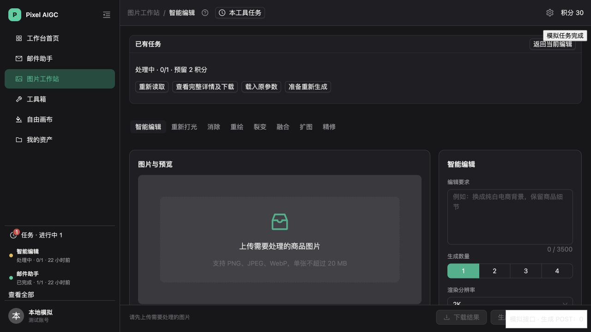
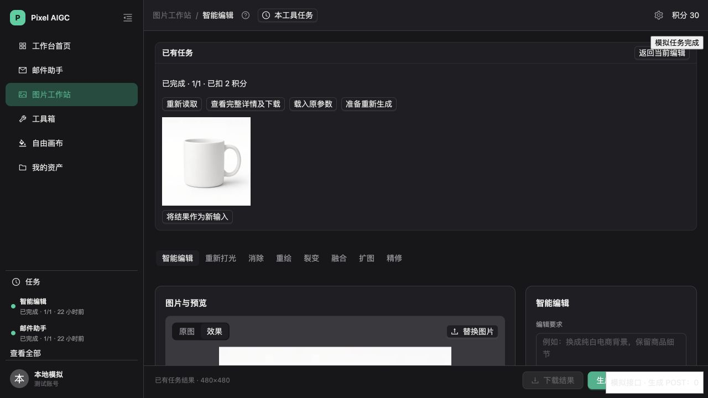

# 任务中心恢复回归修复

基线为 `main/47ae52c`（PR #162），交付分支为 `fix/task-center-recovery-regressions`。本轮修复测试发现的问题，不将模拟浏览器和数据库验证视为完整生产灰度验收。

## 1. 工作站刷新后自动找回任务

普通工作站入口不带 `task` 时，先查询本机保存的原任务身份；没有有效绑定时，通过统一只读历史接口寻找本工具进行中的任务。只有一项时自动打开状态与结果区；有多项时提供选择；画布来源的同名任务不自动绑定工作站。已有明确任务 URL 时保留用户选择。

提交成功后按账号、环境和工具保存原任务编号，因此任务在刷新前已经完成也能找回。终态绑定被消费一次，用户可通过“返回当前编辑”关闭状态区，不会被旧查询缓存反复打开。

发现和恢复均使用任务中心 GET，不调用生成 POST、同步工具的旧推进 GET 或供应商接口。当前输入、原图、蒙版和参数不因发现任务而改变。新生成继续由用户通过原按钮明确发起。

## 2. 结果作为输入的真实尺寸和刷新保留

`TaskRecoveryPanel` 将解码后的图片、真实宽高和 MIME 类型一起传给消费者，工作站资产采用实测尺寸。抠图与转比例智能扩展入口同步采用相同数据契约。

工作站保存最小输入引用：来源类型、原任务编号、结果序号和保存时间。引用按账号、环境、工具隔离，保留 7 天；不保存图片字节、对象键、签名 URL、提示词或蒙版。刷新后仅在当前没有草稿、且没有原生任务正在处理时，重新读取原详情和图片并解码；用户在读取期间开始编辑时保留新内容。上传替换图片或显式载入原参数会清除旧输入引用。

账号或环境切换取消原读取；存储不可用不阻止原任务生成，仍可从服务端任务列表发现。输入引用存在但原对象不可读时显示重新读取提示，不能通过恢复失败自动生成新图。普通转比例继续在本地完成，不进入在线任务中心。

## 3. 已查看 500 的实际原因与修复

业务库的 `aigc_api` 对 `aigc.sync_credit_jobs` 只有 SELECT。原展示接口直接 `SELECT … FOR UPDATE`，需要 UPDATE 权限，实际 EXPLAIN 验证返回 `42501`。图片和邮件原表的权限条件不同。

兼容迁移增加 `aigc.lock_task_center_sync(uuid)`，由受限 SECURITY DEFINER 函数锁定本人、当前环境的原同步任务。函数核对活跃成员与运行环境，使用空 `search_path`，只授予 `aigc_api` 执行权；`public`、`anon`、`authenticated` 不能执行。同步原表仍没有 UPDATE 权限，函数不修改任务或账本。

展示接口在同一事务中锁原任务、重新投影结果版本，再写入原 `task_ui_state`。后台结果写回先取得同一原行锁，旧版本操作在等待后返回 409。保留锁是为了防止新结果被旧的已查看或移除操作隐藏。

迁移先由 CLI 创建文件，通过本地 PGlite 与独立 PostgreSQL 17.10 后，应用到此前已授权的现有业务库。远端迁移版本为 `20261012231944`，源码文件名与实际迁移历史一致。安全 Advisor 与迁移前相同，没有新增告警；权限证据见 [迁移记录](verification/task-center-recovery-fixes/migration.json)。

## 4. 画布离页保护

画布将 `dirty/saving/error` 状态接入原导航门禁。跨工具导航时先调用已有 `flushProject`：保存成功且没有新的未保存修改时直接导航；保存失败或不可写时保留页面并提示。保存等待期间换账号或环境时，不执行旧会话的导航。已保存的项目不再要求用户确认“放弃草稿”。

同页只读任务查看仍保留当前编辑内容；显式参数替换继续复用原确认流程。本轮没有扩大成通用工作站草稿、批量队列或跨设备恢复。

## 5. 验收结果与边界

| 验收层级 | 结果 | 证据 |
| --- | --- | --- |
| 全量本地门禁 | 258 个测试文件、1685 项测试通过；无 Vitest 未处理错误；类型、构建、Lint、差异检查通过 | [本地门禁](verification/task-center-recovery-fixes/local-gates.json) |
| 本地浏览器，模拟接口 | 普通入口自动接回任务；尺寸声明 0×0 的结果实测 480×480；作为输入并刷新后保留，生成 POST 为 0 | [浏览器记录](verification/task-center-recovery-fixes/browser.json) |
| 独立 PostgreSQL 17.10 | 两账号三环境；三源已查看/移除；图片和同步任务实际锁等待；迟到结果旧版本 409；清理不修改原任务或账本 | [并发记录](verification/task-center-recovery-fixes/postgres.json)及 `npm run test:task-center:postgres` |
| 已授权业务库 preview | 实际应用角色对现有图片、同步任务执行已查看/移除并回滚；原任务在锁内保持不变，账本及最终展示状态不变；五种跨账号/环境访问返回 404；原直接锁查询仍返回 42501 | [业务库记录](verification/task-center-recovery-fixes/business-preview.json) |
| 待验收 | 现有 preview 账号没有邮件终态样例，邮件展示操作由本地数据库覆盖；本轮未做已登录远端 HTTP、真实供应商生成或完整生产灰度 | 同左 |

业务库后台维护持续运行。一次跨事务的整表快照比较曾观察到其他任务的维护时间变化；验收因此锁定所操作的原任务核对，并单独核对积分与展示状态，不将后台时间变化误判为展示接口副作用。真实供应商请求和累计新增预留积分均为 0。

本地浏览器热更新阶段出现临时测试页重复 `createRoot` 和文本框高度警告；完整刷新后最终观察仅有既有 React Router 升级提示。构建保留既有大包体积提示，不影响通过。

## 6. 发布与并行 PR

兼容数据库函数已应用；该函数不改变旧客户端、生成、结算或后台调度。API 与 UI 修复需本 PR 合并并部署后生效。其他数据库执行代码部署前须先应用同一迁移。回滚应用代码时保留兼容函数。

提交前发现已有同范围 PR #163。它采用去掉同步原行锁和调用旧单任务接口的恢复方案。本 PR 使用统一只读接口并保留版本竞争所需的原行锁，另包含实际权限与双连接验证。两项 PR 的重叠文件应在评审时选择或整合，不能将两种展示锁实现直接叠加。
