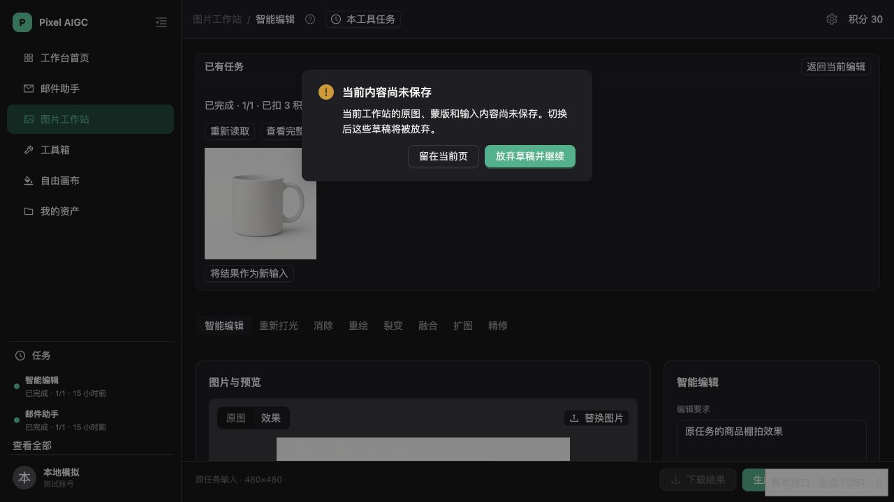
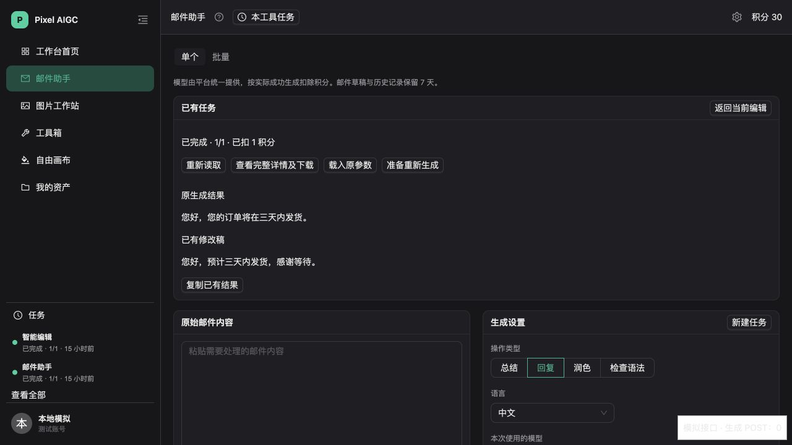

# 任务中心阶段 5：工具定位、恢复与阶段 6 验收

实现基线为 `main/566347f`，交付分支为 `codex/task-center-tool-recovery`。本轮完成工具定位与恢复代码，并补真实预览验收的准备和只读检查。完整浏览器登录、供应商生成与生产灰度仍须完成后续门禁。验收记录取自提交前的工作树；具体 Git 提交以对应 PR 为准。

## 1. 用户行为与交付范围

点击 Sidebar 或工具入口中的任务仍先打开只读详情，再通过“在工具中查看”进入原工具。URL 只携带原任务身份；画布定位另外携带原项目信息。工具页面再次通过统一只读接口验证任务来源、工具和项目，不能通过伪造 URL 跨账号、跨环境或跨项目读取。

| 工具 | 默认打开 | 明确操作后的行为 |
| --- | --- | --- |
| 工作站智能编辑、重新打光、融合、精修、裂变 | 独立展示原任务状态、积分和结果；保留当前输入、原图、蒙版 | “载入原参数”先读取全部原输入，确认后替换表单；“将结果作为新输入”载入原结果 |
| 工作站消除、重绘、扩图 | 展示真实同步任务的原结果；缺少原参数时说明不可完整还原 | 可将已有结果作为新输入，不推测原图或蒙版 |
| 自由画布图片与已有视频 | 按服务端来源验证原项目、场景，复用保存、编辑权和项目冲突门禁 | 有既有恢复记录或占位图时接回原位置；缺少上下文时只读，并提供显式添加结果 |
| 邮件单项及已提交 CSV 行 | 展示原生成文本和已有修改稿，表单保持当前内容 | 显式载入原参数；先保存原修改稿，不自动启动剩余行 |
| 抠图、转比例智能扩展 | 展示已提交原任务 | 显式将原结果添加为一个新单项，不启动剩余批处理 |

“准备重新生成”只执行同样的显式参数载入，并定位原工具生成按钮。用户仍需通过原报价与生成按钮发起新任务；恢复、刷新和参数载入均不提交生成 POST。同步任务没有完整参数时禁用参数载入。

跨工具导航有未保存内容时提供“留在当前页”和“放弃草稿并继续”。正在读取输入、批处理或保存失败时阻止切换。邮件修改稿通过原保存流程收口，画布继续复用项目保存门禁，不新增通用草稿存储。

## 2. 恢复协议与隔离

- `route.ts` 严格解析 `sourceKind:sourceId` 和白名单工具路径。旧画布任务缺少来源时不猜项目，继续只读详情兜底。
- `useRecoveredTask.ts` 只读取任务中心 GET；详情校验账号、环境、任务身份、工具和项目。账号、环境或同页任务变化会取消旧对象读取和参数应用。
- 恢复区共用全局运行层的摘要缓存，结果、状态、数量或积分事实变化才重新读详情；签名到期只重新读取原详情。
- 正在工具内查看、且不在 Sidebar 五条摘要中的任务交由原两并发观察器读取。已终态的当前任务仍观察迟到版本；离开工具后停止额外观察。当前正在查看的任务更新不重复弹完成通知。
- 原画布控制器只暂停 URL 对应原任务的兼容推进轮询。用户明确创建的新任务继续使用原流程；恢复区不调用旧推进 GET。
- 未取得后端任务编号的画布恢复记录可以按原 `requestId` 关联服务端原任务，不能因此重新提交。
- 已有结果按原任务及 ordinal/objectKey 去重；已有资产历史和用户删除记录优先。用户删除的已恢复节点不会在自动恢复时重新插入，迟到的新 ordinal 仍可接回。
- 原输入先完整读取、解码和验证，然后确认替换。任一输入失败保留当前编辑；工作站通过原运行时图片租约保留私有原图，避免加载时被清理或使用失效地址。
- 邮件排队保存携带发起会话身份，执行保存前复核账号与环境。换账号后旧修改稿不发送给新会话。

未保存的整批队列、完整工作站原图和蒙版现场、跨设备草稿恢复继续属于后续范围。本地水印和普通转比例不进入在线任务恢复。

## 3. 后端兼容与部署

没有新增数据库迁移，没有修改任务推进、账本、供应商请求、应用角色权限或生产调度。

任务详情 DTO 新增可选视频元数据，从原 `image_job_items.result_metadata` 读取时长、大小、音轨和保留期限；封面键继续校验归属。旧记录缺失元数据时可以只读播放/下载，不伪造可插入画布的完整视频资产。

同步工作站结果使用实际同步报价请求编号关联历史，避免客户端临时 UUID 让恢复结果重复登记。旧历史结构保持兼容，新关联记录补充来源类型与运行环境。

根 TypeScript 配置的类型库提升至 ES2022，以覆盖现有服务端的 `Error.cause` 和 `Array.at`。编译目标仍为 ES2020；这修复 Vercel 使用根配置编译 API 时的既有类型诊断。

预览只对部署传入 `TASK_CENTER_ENABLED=true`、`AIGC_RUNTIME_SCOPE=preview`，不覆盖生产变量。预览来自工作树上传，部署 Git 元数据仍指向基线，不能等同于实现已提交或合并。最终地址与状态见 [部署证据](verification/task-center-stage-five/deployment.json)。

## 4. 已完成验收

| 层级 | 结果与边界 | 证据 |
| --- | --- | --- |
| 全量本地门禁 | 257 个测试文件、1671 项测试通过；无 Vitest 未处理错误；服务端与前端类型、构建、Lint、差异检查通过 | [本地门禁](verification/task-center-stage-five/local-gates.json) |
| 本地浏览器，模拟接口 | 实际工作站、邮件、布局与路由组件：独立结果区、显式参数载入、跨工具草稿取消/确认、邮件原结果与修改稿、刷新后只读重接；生成 POST 为 0 | [浏览器记录](verification/task-center-stage-five/browser.json)及下方截图 |
| 375 像素页面 | Sidebar 收起为图标；恢复操作换行，页面无横向溢出；工作站原图正确解码为 480×480 | [窄屏截图](verification/task-center-stage-five/04-workstation-375.png) |
| 现有业务库 preview，只读 | 使用实际应用角色、强制 READ ONLY 事务，读取两个已提供账号的列表、原请求和原生快照；跨账号原任务读取返回 404；不调用生成、不预留积分 | [数据库记录](verification/task-center-stage-five/business-preview-readonly.json) |
| Vercel 预览 | 最终部署 READY；构建日志无 TypeScript API 编译错误；前一迭代通过 CLI 到达应用并返回 `401/AUTH_REQUIRED`，最终域名的浏览器与 CLI 访问遇到连接关闭 | [部署证据](verification/task-center-stage-five/deployment.json) |

数据库验收与本地模拟不能替代已登录 HTTP 的完整真实链路。业务库抽查的一条记录在 SQL 摘要中声明有图片，但详情对象检查后不可读取；正确保留执行和账本事实，没有新建图片。两个账号的首批历史分别为 0 和 20 条，所检查历史没有视频，不能据此断言整个库没有视频。

本地截图使用公开示例图及模拟文本，不包含真实用户图片、邮件、对象键或令牌。

## 5. 真实链路剩余门禁

前一迭代浏览器预览受到 Vercel 访问保护，最终域名又遇到连接关闭；当前尚无业务测试账号的正常登录会话。用户后续已确认两个已提供的邮箱均为测试账号，并明确暂不能登录保护预览，先交付代码与已完成验收。真实登录和收费链路保留为待验收；账号验证或管理员 SQL 不作为业务登录的替代。

1. 在最终预览通过现有 Vercel 登录并正常登录两个指定业务测试账号，核对 `/me` 身份、`runtimeScope=preview` 和开关。
2. 在累计预留不超过 30 积分、退款不补充预算的约束下，跑最小异步图片和同步工具真实提交、离页、刷新、恢复、下载与账本闭环。
3. 补免费抠图、邮件已提交行、画布原项目/场景及迟到结果的真实链路；确认没有恢复生成 POST、重复资产或草稿覆盖。
4. 验证已完成原任务在另一账号不可读、晚响应不进入新账号，并执行签名到期与对象缺失场景。
5. 新视频最低预留 50 积分，超过本轮预算；仅验收已有可读取视频，否则保持待验收，不新建收费视频。
6. 实查临时结果生命周期和后台分钟推进，完成以上真实门禁后再安排完整生产灰度。

本轮截至交付累计预留 **0/30 积分**，没有真实供应商生成。生产灰度未开始，阶段 2 原维护和安全补提交范围保持现状。

提供只 GET 的 `npm run test:task-center:http`：拒绝生产地址，要求两个不同测试账号及当前登录令牌，令牌只从进程环境读取；检查 `/me`、集合、原请求、详情、跨账号 404、真实对象下载和图片解码。脚本不保存正文、签名或令牌，不创建任务；需要先有可读取的已完成预览任务。

## 6. 交付与回滚

本轮通过特性分支 PR 交付，目标分支为 `main`。完整生产灰度以真实链路剩余门禁完成为前提，不因本地测试或 READY 状态提前宣布验收完成。

回滚关闭任务中心开关并部署，停止新增定位与恢复入口；保留兼容接口、来源与展示数据，不停止阶段 2 后台图片维护，不扩大收费补提交范围。
