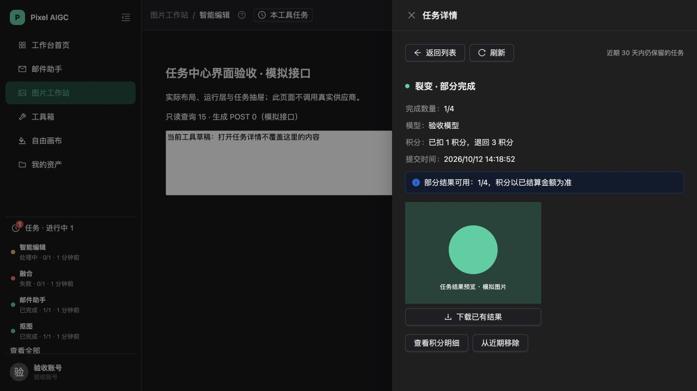
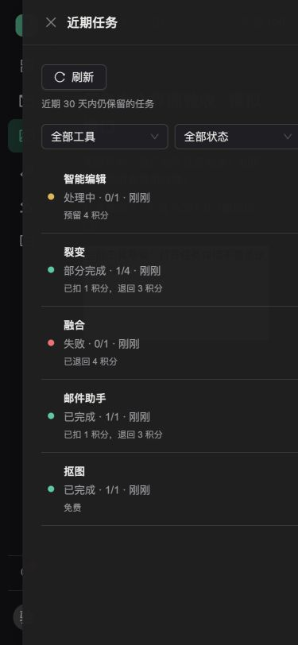

# 统一任务查询与全局任务中心：实现与验收

实现基线为 `main` 的 `5bbc57a`，接口分支为 `codex/task-center-query-api`，界面分支为 `codex/task-center-global-ui`。本轮实现阶段 3、4，并接入阶段 5 的来源和工具任务入口。点击任务打开只读详情；工具恢复和完整生产灰度验收仍属于后续范围。

## 1. 已交付行为

- Sidebar 展示最多五条，进行中优先，其余为未查看、未移除的终态；服务端返回真实进行中与未查看数量。
- 共用抽屉支持工具、状态筛选、分页，查看图片、视频、邮件原结果及已有修改稿，下载或复制已有结果，转入原积分明细抽屉。
- 查询统一投影 `image_jobs`、`sync_credit_jobs`、`email_tasks`，免费抠图与已有视频同样可发现。执行、积分、可用性独立表达；缺少可信结算凭据时金额为 `null`。
- 来源记录与首次创建在同一事务中落库，重入保留首次来源；来源不参与报价、指纹或供应商请求。旧客户端不传来源继续可用。
- 原工具生成、画布恢复和已提交邮件行保持原流程。任务中心不会还原输入、切换项目、登记素材、重发生成或启动剩余批处理。

## 2. 数据与接口

迁移文件：[20261012061117_task_center_query.sql](../supabase/migrations/20261012061117_task_center_query.sql)。文件先由 CLI 生成，经过独立数据库验证后通过 Supabase 迁移工具应用；文件版本已对齐远端迁移记录。

仅修改 `aigc`：三类任务的可空 `origin`、`task_ui_state`、来源校验与版本纯函数、六参数同步预留重载及展示清理函数。原五参数 RPC 保留。应用角色仍无同步任务表 `UPDATE` 权限；`anon`、`authenticated` 无展示表直接访问权限。展示状态按用户、环境和原任务归属实施 RLS。

| 接口 | 行为 |
| --- | --- |
| `GET /api/task-center?view=sidebar` | 五条摘要、进行中/未查看数量、快照时间 |
| `GET /api/task-center?view=history` | `tool`、`state`、`limit`、`cursor`；默认 20，上限 50 |
| `GET /api/task-center/by-request/:kind/:requestId` | 按原请求读取摘要，不生成 |
| `GET /api/task-center/:kind/:id` | 已验证归属的详情；事务外 HEAD、签名 |
| `PATCH /api/task-center/:kind/:id/presentation` | `seen`/`dismiss` 与观察到的 `outcomeVersion` |

来源类型为 `image_job`、`sync_credit`、`email_task`；状态筛选为 `all`、`active`、`succeeded`、`failed`。失败包含失败与超时，移除任务仍在历史中。

所有 GET 在数据库 `REPEATABLE READ READ ONLY` 短事务中取得快照，独立于旧任务 GET 的兼容推进逻辑。对象检查失败只改变可用性；不改变成功与积分事实。保持 `no-store`，环境只取服务端配置。非法参数 400；不可访问统一 404；有原记录过期或删除证据才返回 410。404 不授权重新生成。

游标使用创建时间、来源与编号排序，保留六位微秒，并绑定账号、环境、筛选和首次查询时间。无效日期或越过上界的游标拒绝为 400。

版本在 SQL 中由原身份、终态、错误码及稳定结果身份生成 `v1` 摘要；签名、积分刷新和邮件修改稿不参与。展示写入锁定原任务，旧版本返回 409。迟到补图使旧查看/移除标记失效；进行中不能移除。

每日维护只清理当前环境的展示数据，按创建时间最多保留 30 天，删除原记录对应的孤立展示项，每轮上限 500；不新增调度，不修改任务、对象或账本。

同步任务无原结果有效期列，R2 七天策略仍须实查，故 `resultExpiresAt=null`，不将创建后七天或签名期限当作已证实的对象期限。详情的对象缺失显示不可用；视频、邮件遵守原有效期。

## 3. 运行层与提交凭据

运行层挂在账号就绪的布局中，独立于工具页面、侧栏展开和抽屉。所有缓存按账号和服务端环境隔离，切换时关闭抽屉、取消读取、删除旧缓存及内存任务。响应应用前复核身份；原 Axios 请求、单任务轮询和任务视频下载也有会话保护。

有进行中、已观察任务或待确认凭据时每 8 秒读摘要，无进行中时 30 秒。页面隐藏暂停周期读取；聚焦、网络恢复和提交事件刷新。连续失败按 8/16/30/60 秒退避，保留可信快照。侧栏外任务通过原请求摘要继续观察，读取并发为二；每轮最多 50 项并轮换，避免遗漏后面的观察项。

本次会话终态按任务与版本通知一次；初次加载历史不通知。正查看该任务时直接更新详情。旧工具的共享查询由每个消费者分别观察数据，邮件成功提示移交统一协调器，输入、提交和结果读取错误仍由原工具提示。

在线 POST 前保存最小凭据：账号、环境、来源类型、原请求、入口、时间。账号环境最多 50 条，保留七天，不保存正文或图片。404、断网与响应丢失只查询原请求，不自动 POST；用户可移除提示，操作不代表取消或退款。画布只在现有恢复记录中保存来源，不另建凭据。

Sidebar 在 68 像素、窄屏及短视口提供图标入口；任务区高度上限 `min(280px,35vh)`，导航和账号仍可达。抽屉按需加载；窄屏工具任务入口保留名称和键盘访问。

## 4. 验收证据与边界

| 层级 | 已验证 | 证据 |
| --- | --- | --- |
| 全量本地 | 248 个文件、1616 项测试；无 Vitest 未处理错误；构建、类型、Lint、差异检查通过 | [本地门禁](verification/task-center-stage-three-four/local-gates.json) |
| 独立 PostgreSQL 17.10 | 实际应用角色、两账号三环境、只读查询不改变任务账本；真实锁等待后旧版本 409；清理隔离 | [双连接验收](verification/task-center-stage-three-four/postgres-concurrency.json) |
| 现有业务库 preview | 兼容迁移成功；真实应用角色调用路由和数据库；23 条历史、五条侧栏；展示写入与读取隔离；原任务账本一致 | [业务库验收](verification/task-center-stage-three-four/business-preview.json) |
| 本地浏览器模拟 | 68/168/260 侧栏、375/768 页面、短视口；部分完成、免费、邮件结果、工具筛选、草稿保留；生成 POST 为零 | [布局数据](verification/task-center-stage-three-four/browser-layout.json)、下方截图 |
| 真实预览 HTTP 登录 | 当前机器的浏览器与 CLI 对预览域名均连接被关闭；MCP 读取又遇到部署保护 401，尚未到达应用登录链路 | 待网络可达后补验 |
| 生产展示 | 默认关闭，未发布任务中心 UI 灰度；阶段 2 原维护开关和安全补提交范围未改变 | 后续发布门禁 |

业务库验收是实际数据库、应用角色和路由内部调用，不能等同于浏览器→已登录 HTTP→R2 的完整链路。该链路及真实图片/视频下载、存储生命周期和正式灰度仍须补验。复制结果传参、展示写入和旧响应隔离另由组件/接口测试覆盖。





其余证据：[邮件](verification/task-center-stage-three-four/02-email-detail.png)、[168 像素侧栏](verification/task-center-stage-three-four/04-sidebar-168.png)、[68 像素侧栏](verification/task-center-stage-three-four/05-sidebar-68.png)、[短视口](verification/task-center-stage-three-four/06-short-viewport.png)。

## 5. 交付、发布与回滚

PR 1 包含 `shared/task-center.ts`、`server/task-center/`、原任务来源写入、迁移、后台展示清理、后端验收脚本和服务端开关，目标分支为 `main`。PR 2 包含运行层、Sidebar、抽屉、账号缓存及请求隔离、凭据和工具入口，先以接口分支为目标创建依赖 PR，供分别审查。接口 PR 合并后，再将 UI 分支整理到最新 `main` 并调整目标分支。既有预览是提交前的工作树上传，部署记录保留当时的分支和基线信息，不能据此认定远端已部署本次 Git 提交。

`TASK_CENTER_ENABLED` 默认关闭。开启后由 `/me.features.taskCenter` 告知前端，停用返回 `503/TASK_CENTER_DISABLED`，前端停止查询。最新 [预览部署](https://pixel-aigc-jrtoafm2o-ningnings-projects-2ed21e15.vercel.app) 已由 Vercel MCP 确认 `READY`。CLI 的后续构建跟踪发生授权错误，因此部署状态以 MCP 实查为准；工作树上传不等于已提交代码。

预览部署只对该次部署传入 `TASK_CENTER_ENABLED=true`、`AIGC_RUNTIME_SCOPE=preview`；不覆盖生产环境变量。

发布顺序：本地门禁 → 兼容迁移（已应用）→ API → 已登录预览联调 → UI → 生产灰度。网络不可达时不得将本地模拟验收记成完整预览验收。预览部署编号及工作树信息另见 [部署记录](verification/task-center-stage-three-four/deployment.json)。

回滚关闭展示开关并重新部署，保留来源、展示数据和兼容接口；不暂停阶段 2 的分钟维护，不扩大安全补提交。

本地独立库验收：

```sh
TASK_CENTER_TEST_DATABASE_URL='postgres://测试用户@127.0.0.1:端口/空白独立库' \
TASK_CENTER_TEST_DATABASE_CONFIRM=isolated npm run test:task-center:postgres
```

脚本拒绝远端和非空库，不删除已有 schema。业务库验收脚本需要显式 `TASK_CENTER_PREVIEW_CONFIRM=existing_business_preview`、`AIGC_RUNTIME_SCOPE=preview` 和两个已确认测试账号，禁止灌入 bootstrap。
