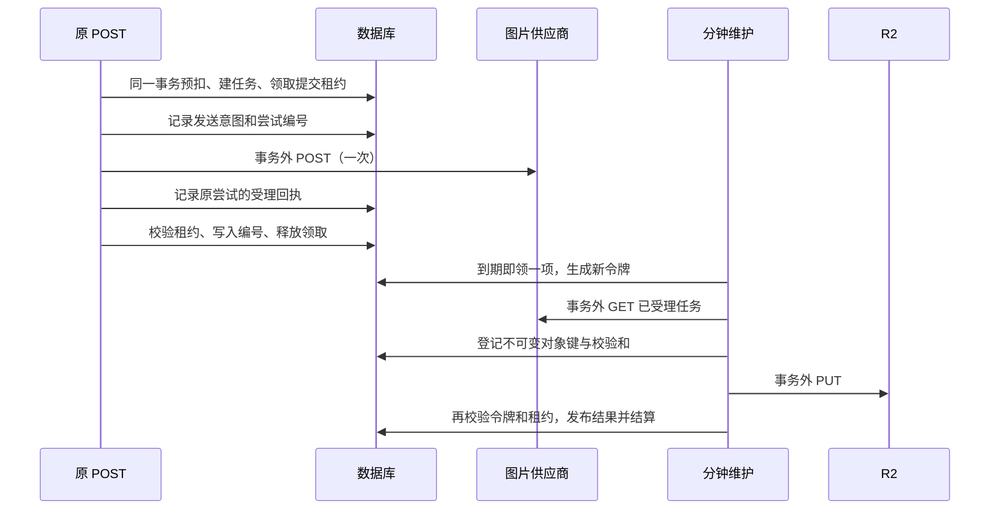

# 任务中心阶段 2：后台可靠推进

| 项目 | 当前事实 |
| --- | --- |
| 实现基线 | PR #152 合并后的 `main`，`a8a78b1ff981ccc9c3177396d0cda5f713a09c94` |
| 开发范围 | 原请求即时提交；后台接续图片查询、转存、结算和同步工具超时退款 |
| 本地验收 | 持久化协议、迁移/RLS/账本、真实 PostgreSQL 双连接竞争；供应商为 Mock，对象存储为内存替身 |
| 预览验收 | 已在用户授权的现有业务库中完成 preview 分钟调度、实际 R2 PUT、唯一预扣/结算和两账号/三环境隔离 |
| 生产状态 | 共享业务库已应用兼容迁移；生产应用仍是 main，未创建生产图片分钟调度、未开启生产后台开关；真实供应商与账单验收留阶段 5 |
| 后续范围 | 阶段 3 建统一只读查询；后续阶段接任务列表和工具定位。此次不交付任务中心界面 |

关联：[总计划](task-center-development-plan.md)、[任务契约](task-center-contract.md)、[故障矩阵](task-center-failure-matrix.md)。

## 1. 执行与计费协议

原 POST、兼容的任务 GET 和分钟维护使用同一个 `advanceImageClaim` 推进器。创建、领取、记录意图、写回和计费分别使用短事务，供应商请求、缓存读取、下载、裁剪和 R2 写入在事务外执行。



同步返回图片的 OpenRouter/AI Gateway 在原请求里继续收取已生成缓存。异步供应商的原请求登记上游编号后返回，后台接着推进。

### 1.1 提交状态与安全重试

| 明细 `submission_state` | 事实与处理 |
| --- | --- |
| `not_sent` | 已确认未发送，或明确拒绝后允许下一次尝试；须重新取得租约并持久化新的意图 |
| `sending` | 意图已提交，真实请求尚未取得持久化回执；其他执行者不能再次 POST |
| `accepted` | 已保存供应商编号或核验了同一次尝试的缓存；只查询、下载和转存 |
| `unknown` | 超时、断链、5xx、响应无编号或进程硬停；不能推导为未受理，也不能盲目 POST |
| `NULL` | 迁移前的旧项。有编号可接续；无编号保守转为 `unknown` |

生成 POST 不在 HTTP 客户端里自动重试。只有 `requestSent=false`、明确拒绝或已验证的限流拒绝才能回到安全尝试路径；GET 查询保留有限重试与退避。新尝试复用原任务、预扣和截止时间，不给任务续期。

`aigc.image_job_attempts` 只记录发送/转存凭据，不充当另一套任务或计费表。表按账号与环境实施 RLS，`anon`/`authenticated` 无访问权；记录不保存提示词、图片字节、密钥或签名 URL。

原执行者在租约失效后只能补原提交尝试的回执，不能写任务进度、发布结果或结算。当前持有者读取回执继续接原编号。OpenRouter/AI Gateway 用以下服务端身份隔离缓存：

```text
temporary/{provider}-results/{scope}/{userId}/{jobId}/{attemptId}/{ordinal}.img
```

`recoverSubmission` 只读取这个缓存。未命中直接返回，不能调用会生成图片的 `submit` 探测。缓存未成功写入且上游编号丢失的任务，仍可能无法找回；按原截止规则退款，平台上游成本可能已发生。

### 1.2 租约、预算与并发

| 限制 | 实现值 |
| --- | --- |
| 图片租约 | 数据库时钟计算 120 秒，每次重领换随机 UUID 令牌 |
| 原请求/兼容 GET 的总 I/O 预算 | 最多 110 秒，并受 Vercel 实际 deadline 减 8 秒约束 |
| 维护总 I/O 预算 | 最多 90 秒，同样留出数据库收尾时间 |
| 数据库短事务 | 单条语句最多 8 秒，锁等待最多 5 秒 |
| 单次对象操作 | 传入后台预算信号时，R2 GET/PUT/DELETE 最多 30 秒；读取正文也可中止 |
| 本轮维护 | 最多领取 4 项，本进程同时处理 2 项；每个空闲槽即时领取一项 |
| 多实例约束 | 同一环境最多 4 份有效维护租约，数据库共同计数 |
| 上游限制 | 保留既有供应商进行中上限；3.0 Pro 的平台提交预算跨账号/入口共用 4 次/分钟，拒绝也计数 |
| 截止后补收 | 原 24 小时窗口，约每 5 分钟尝试；只接已有编号、回执和缓存 |
| 清理上限 | 每轮图片/同步预留各最多 100 条；孤儿对象最多 10 个 |

领取使用原任务行的 `FOR UPDATE SKIP LOCKED`。旧令牌被数据库触发器和账本函数拒绝，应用层的 `alreadyLeased` 不能绕过检查。没有长事务等待上游。

总预算或单次超时结束时停止外部操作，下轮通过原凭据接续。预算不足以执行提交时不登记 `sending`，释放领取等待下一轮；不在一个维护调用里长时间等待生成完成。

### 1.3 结果写回、迟到结果与清理

结果对象键包含独立转存尝试编号，旧执行者无法覆盖新对象：

```text
generated/{userId}/{scope}/{jobId}/{ordinal}/{transferAttemptId}.{ext}
```

PUT 前先登记键、类型、尺寸和 SHA-256。PUT 已成功但数据库写回失败时，下轮核验原对象并发布，避免重新生成、重复下载。对象未找到可重新收取原上游结果，不重新 POST。

新图片对象的读取、重签和作为输入使用均校验键中的环境；同账号不能从预览读取新的生产图片键。既有不带环境的图片键保持兼容。

积分继续使用原 `BillingPort`、积分账户和账本。到期前的部分成功按已入库张数结算；截止后先冻结已入库收费，再补收，迟到图不追加收费。无成功项退款；免费抠图保留 `delta=0` 的真实收口流水。

孤儿转存至少 24 小时后才清理。领取清理前排除有效执行租约、仍可补收的任务，以及被图片明细、资产、同步结果或其他图片输入引用的对象。清理先持久化占用，再在事务外删除；已发布对象不会被当作孤儿。

四种同步工具只补超时预留收口，不重跑原生成请求。主体检测和智能选区保持原权限、配额及七天观测记录。视频与邮件保留原执行器，图片领取和图片到期清理均排除 `text_to_video`。

## 2. 环境、迁移与开关

新迁移：[20261011230130_image_job_reliable_maintenance.sql](../supabase/migrations/20261011230130_image_job_reliable_maintenance.sql)。新协议列可空，既有任务保留旧值；不回填“未发送”，不修改余额或创建另一套账本。

2026-10-12 用户授权改用现有业务库。迁移已应用到 `content-up`（`gnrhyahjegvcicektebh`），远端版本 `20261011230130`；本地文件与远端记录对齐。迁移只修改 `aigc`，不修改 `auth/public/edm` 或其他产品调度。旧生产每日清理未设置 scope，为滚动升级保留仅无用户身份可调用、固定为 production 的清理兼容入口；新维护和用户请求仍显式设置范围。确认全部旧部署排空后可移除该兼容入口。

第二份已应用迁移：[20261012001546_image_job_pending_salvage.sql](../supabase/migrations/20261012001546_image_job_pending_salvage.sql)。它修复截止后缓存读取失败时，任务已收口而明细仍为 pending 的补收遗漏；只有已有编号或原尝试凭据的项能领取，不允许截止后重新 POST。

| 服务端变量 | 默认值与作用 |
| --- | --- |
| `IMAGE_CRON_SECRET` | 独立随机密钥；三个环境分别配置，不能复用视频密钥 |
| `IMAGE_MAINTENANCE_ENABLED` | `false`；控制内部维护入口是否接收调度 |
| `IMAGE_BACKGROUND_SUBMIT_ENABLED` | `false`；控制后台/兼容 GET 是否允许安全补提交。关闭后仍可收已受理结果并超时收口 |
| `AIGC_IMAGE_MOCK_PROVIDER` | `false`；仅独立预览/本地验收使用；正式环境强制隐藏且拒绝执行 |
| `IMAGE_MOCK_DELAY_MS` | `0`；Mock 最多延迟 240 秒，便于验证关页后接续 |

部署顺序：

1. 首选独立测试库；此次按用户明确授权复用现有业务库，先检查 AIGC/EDM 影响和旧生产调用兼容性，再应用经过本地验证的迁移。空白 PostgreSQL 并发脚本仍只运行在本地独立库，不能向业务库灌入整套测试数据。
2. 发布兼容代码，两项后台开关均保持关闭。原请求继续即时提交；代码依赖新列，必须先迁移。
3. 确认旧部署不再接收图片提交，至少等待 150 秒排空旧执行者，再检查是否有仍在执行的旧调用。新执行器接管旧项后，旧协议写回会被拒绝；等待时间本身不能代替部署排空检查。
4. 配置稳定预览地址、分支专属开关/密钥、预览测试账号、R2 和 Vault；创建独立的图片预览分钟调度。复用桶时新对象键必须包含 preview 范围。先启用维护收取已受理结果，再按验收需要启用安全补提交。
5. 完成下方预览验收，记录数据库、R2 与完成日志证据。共享库的兼容迁移已应用；生产应用发布、生产开关和真实小额供应商验收仍在阶段 5 单独执行。

回滚时先关闭 `IMAGE_BACKGROUND_SUBMIT_ENABLED`，保持维护收图和退款；如维护器自身故障，再关闭 `IMAGE_MAINTENANCE_ENABLED`/仅暂停图片调度，保留每日兜底。保留兼容代码、凭据列、账本与对象，不退回缺少 fencing 的旧图片执行器，不删除新列。不要暂停或改写视频、邮件及其他产品的调度。

## 3. Supabase 分钟调度

`POST /api/internal/image-jobs-maintenance` 先校验独立 Bearer 密钥，再严格接受 `{ "scope": "preview" }` 并核对运行环境。该接口无用户登录依赖；环境不匹配返回 400，密钥无效返回 401，维护开关关闭返回 503。

响应 `202 { received, runId, scope }` 只证明调用被接收。`waitUntil` 持续执行仍受函数时限约束，不能替代下一次分钟调用。必须查同一 `runId` 的 `image-maintenance-complete` 日志及任务/对象/账本，不能用 202 或 cron 的 SQL 成功证明收图完成。

调度模板：[image-jobs-cron.example.sql](../supabase/operations/image-jobs-cron.example.sql)。它只创建/更新预览图片调度，不放入迁移，不包含真实密钥。在预览使用的库启用 `pg_cron`、`pg_net`、`supabase_vault` 并预先设置以下唯一 Vault 名称：

- `aigc_image_maintenance_url_preview`：包含 `/api/internal/image-jobs-maintenance` 的完整稳定 HTTPS 地址。
- `aigc_image_maintenance_secret_preview`：与该部署的 `IMAGE_CRON_SECRET` 一致。
- `aigc_image_maintenance_bypass_preview`：仅当部署保护需要时配置；使用授权的 Vercel bypass secret，不关闭整个站点保护。

先按名称查询 Secret ID，存在时用 `vault.update_secret`，避免重复创建同名密钥。不要查询并打印 `decrypted_secret`，不要提交替换成真实值的 SQL。生产后续使用独立的 `_production` 名称、调度名、URL、密钥以及 body 中的 `production`；复用业务库时依靠显式 preview 范围和 RLS 隔离。

分钟调度属于周期推进，正常目标是上游完成后的下一至两轮完成收取；大图转存时间另测，不承诺固定秒数。接口仍保留旧业务 GET 的兼容推进，统一只读任务中心 API 在阶段 3 拆出。

## 4. 本地验证与真实并发门槛

日常检查：

```sh
npm test
npm run build
npm run lint
git diff --check
```

新增协议测试涵盖 F01/F02、未知提交禁止重提、明确未发送的安全新尝试、迟到回执、PUT 后写回失败、部分成功收费冻结、批量序号与成本、超时预算、环境密钥、生产禁止 Mock、缓存隔离、RLS/账本及孤儿对象保护。

最终本地结果：240 个测试文件、1,576 项测试通过，无 `Unhandled Errors`；构建通过。Lint 在构建结束后独立执行，避免 Vite 临时配置文件在扫描期间被删除。

2026-10-12 合并前复核修正两处问题：收尾保留数据库已写入的平台限流退避；兼容 GET 根据实际明细判断部分成功任务的截止后补收。两项回归均纳入上述全量测试，真实 PostgreSQL 双连接验收也在修复后重新通过。此前预览部署未包含这两项后续修复，提交 PR 后仍需核对该提交的 CI 和部署结果。

PGlite 执行实际迁移和应用角色权限，但不能证明两个真实 PostgreSQL 连接的并发行为。独立并发脚本是另一道门槛：

```sh
# 必须由操作者提供专用空白库；本命令不会加载 .env.local。
IMAGE_TEST_DATABASE_URL='postgres://测试账号@127.0.0.1:5432/专用空白库' \
IMAGE_TEST_DATABASE_CONFIRM=isolated \
npm run test:image-jobs:postgres
```

脚本拒绝业务连接、已有业务 schema/表；不删已有数据，不在缺少真实连接时改用 PGlite。远端空白 PostgreSQL 另须 `IMAGE_TEST_ALLOW_REMOTE=true`，保持 TLS；它不是向含 Auth 表的 Supabase 项目灌测试数据的工具。脚本创建测试所需角色、迁移和两个测试账号，同一临时集群的不同空白库可复用角色，不能在业务集群运行。

真实连接验证了：原 POST 等待时 GET/维护不能争抢，无网络等待事务；两个执行者的旧进度/旧结算被拒；迟到回执由另一连接消费；跨实例四项上限；被锁行跳过；三个环境清理隔离；无用户 GET 时维护独立转存并结算。

2026-10-12 本地 PostgreSQL 17.10 的双连接报告保存在 [postgres-concurrency.json](verification/task-center-stage-two/postgres-concurrency.json)。这是 Mock + 内存对象存储证据，`previewVerified=false`，不是 Supabase 分钟调度、真实 R2 或供应商账单证据。

## 5. 预览验收结果与剩余完整验收

稳定地址：[阶段 2 预览](https://pixel-aigc-stage2-preview-ningnings-projects-2ed21e15.vercel.app)。六项专属环境变量仅绑定 `codex/task-center-reliable-maintenance`，生产开关保持关闭。预览受到 Vercel 部署保护，调度使用本次专用凭据。

在现有预览测试账号下创建一项 Mock 任务后，不调用用户任务 GET。分钟维护依次在北京时间 08:20 提交、08:21 等待、08:22 完成转存和结算。数据库显示 succeeded/settled、收费 1；提交尝试、转存意图、reserve 和 settle 均各一条。验收账号的生产余额/流水摘要没有变化，该任务在其他环境没有账本记录。

实际应用连接以 `aigc_api` 测试两个账号、三个 scope：只有本人 preview 能读到任务及两条凭据，其余组合均为零。Supabase cron 执行、pg_net 的 202/runId 与 Vercel 的 `image-maintenance-complete` 日志已交叉核对，完成轮 claimed/advanced/terminal 均为 1，failed 为 0。

完整证据：[preview-maintenance.json](verification/task-center-stage-two/preview-maintenance.json)。当前验收供应商是 Mock；R2 PUT 使用部署的真实配置。没有执行真实浏览器关页操作、直接下载核验或收费供应商测试，不能把这些写成通过。

可复用的预览工具：[image-job-preview-check.ts](../scripts/image-job-preview-check.ts)。它只创建一项 preview Mock 原任务并释放发送前领取，随后由调度推进；不初始化 schema，不创建 Auth 账号。管理员先确认测试账号，再使用下面命令；check 只读取原任务，不调用推进接口。

```sh
AIGC_RUNTIME_SCOPE=preview AIGC_IMAGE_MOCK_PROVIDER=true \
IMAGE_PREVIEW_VERIFY_CONFIRM=existing_business_preview \
IMAGE_PREVIEW_USER_ID='已确认的预览测试账号 UUID' \
IMAGE_PREVIEW_REPORT_PATH='/private/tmp/专用私有报告.json' \
npm run test:image-jobs:preview -- create

AIGC_RUNTIME_SCOPE=preview \
IMAGE_PREVIEW_VERIFY_CONFIRM=existing_business_preview \
IMAGE_PREVIEW_REPORT_PATH='/private/tmp/专用私有报告.json' \
npm run test:image-jobs:preview -- check
```

| 场景 | 操作与必须保留的证据 | 当前状态 |
| --- | --- | --- |
| 无用户查询时完成 | 延迟 Mock 创建后停止用户查询，通过 SQL 与完成日志核对转存和唯一结算 | 远端分钟维护和实际 R2 PUT 通过；真实浏览器关页/直接下载待完整验收 |
| 原提交被打断 | 在供应商已受理、编号尚未发布的窗口中止执行；下一轮核对原回执/缓存，不增加生成请求 | 本地故障注入通过；预览待验 |
| PUT 后中止 | 保留转存意图与已写对象，阻断最终数据库事务；下轮核验同一对象、发布一次 | 本地故障注入通过；真实 R2 待验 |
| 旧租约返回 | 两执行者竞争，旧令牌尝试写 10，新令牌已写 80；检查旧写回和旧账本被拒 | 真实 PostgreSQL 双连接通过；预览待验 |
| 维护重叠/超时 | 同时调用两个维护实例，记录不同 runId；强制预算结束；有效维护领取不超过 4，下轮可接续 | 本地双连接/预算通过；正常远端调度通过；远端故障注入待完整验收 |
| 同步工具与免费抠图 | 制造到期预留，分钟维护后查询退款流水；零积分分支只产生真实零分收口 | 本地迁移与账本通过；预览待验 |
| 账号/环境边界 | 两账号、三 scope 的任务/凭据/超时清理隔离；正式配置误开 Mock 仍不暴露、不执行 | 本地与远端实际应用角色读取隔离通过，生产 Mock 禁用本地通过 |
| 原业务回归 | 视频/邮件维护、画布恢复、工作站、同步工具与资产读取按原流程冒烟 | 既有自动测试通过；预览冒烟待验 |

预览验收使用 preview 积分和 Mock 供应商，R2 结果写入带 preview 的新对象键，不能消耗生产积分或调用收费供应商。真实供应商、生产调度、生命周期策略与上游账单核对属于阶段 5。

## 6. 观测与故障处理

每轮完成日志包含 `runId/scope/claimed/advanced/terminal/unknown/fenceRejected/failed/imageExpired/syncExpired/orphansDeleted/budgetExhausted/durationMs`。失败日志只记录错误类别，不带提示词、图片字节或密钥。

只在对应环境的授权管理连接执行聚合观察，下面固定为预览：

```sql
select count(*) as due_jobs, min(next_poll_at) as oldest_due
from aigc.image_jobs
where scope='preview' and capability<>'text_to_video'
  and status in ('queued','processing') and next_poll_at<=now();

select count(*) as overdue_reservations, min(deadline_at) as oldest_deadline
from aigc.image_jobs
where scope='preview' and capability<>'text_to_video'
  and billing_state='reserved' and deadline_at<=now();

select count(*) as unknown_items
from aigc.image_job_items
where scope='preview' and submission_state='unknown' and result_object_key is null;

select jobname, active from cron.job
where jobname='aigc-image-maintenance-preview';
```

连续失败先检查调度网络响应、稳定 URL/部署保护、密钥与 scope，再按 runId 查完成日志。待确认项增多时检查原提交回执、供应商连接和缓存写入；不能把 `unknown` 批量改成 `not_sent`。大量预算结束时检查对象下载/上传耗时与任务积压，不能增加一次预领取的任务数量。退款异常按原 task/ledger 事务定位，不人工创建第二套收费状态。
